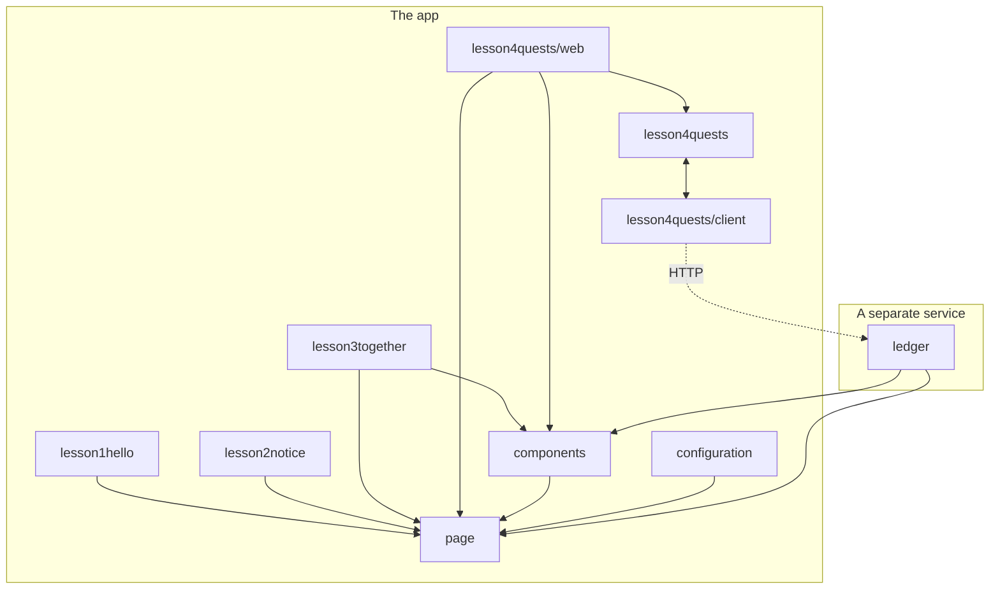

# Forgelord

A starter for web apps in Kotlin and Spring MVC, with [Streamlord](https://streamlord.sobernetics.no)
and [LO-TEK](https://lo-tek.sobernetics.no). Five lessons, each a step from the one before: a page
that says hello, a list with a button, the same list kept up to date in every open window, a
quest board from [Gallowmark](https://github.com/MarkusAugust/gallowmark) that reads its quests
from another service, and a page you build yourself. Nothing here needs Node or npm.

- [How the pages work](#how-the-pages-work), and how to [run it](#run-it)
- [Lesson 1: Hello](#lesson-1-hello)
- [Lesson 2: A list and a command](#lesson-2-a-list-and-a-command)
- [Lesson 3: Every window sees it](#lesson-3-every-window-sees-it)
- [Lesson 4: The board](#lesson-4-the-board)
- [Lesson 5: Your own page](#lesson-5-your-own-page)
- [When you build on it](#when-you-build-on-it)
- [For coding agents](#for-coding-agents)

## How the pages work

The server writes all the HTML. [Datastar](https://data-star.dev), one small script in the browser,
sends what you typed to the server as JSON, and the server answers with new HTML for a part of the
page. You write no JavaScript: what to show, and what is valid, is decided on the server.
Streamlord is the Kotlin side of that: it reads what Datastar sends and writes what it gets back. LO-TEK is the design
system: you call `Lt.button()`, and the button gets LO-TEK's classes.

The words the code and the lessons use:

- **Signal.** A named value Datastar keeps on the page. `dataBind(HelloSignals::name)` ties a
  field to the signal `name`, and Datastar sends every signal as JSON with each request:
  `{"name": "Ada"}`.
- **Patch.** HTML the server sends for one part of the page. Datastar finds the element on the page
  with the same `id` and puts the new one in its place.
- **Morph.** How Datastar puts it in place: it changes only what differs, so a field you are typing
  in keeps its text and the cursor.
- **Stream.** Every Datastar answer here is a stream of server-sent events (SSE). In lessons 1
  and 2 it carries one patch and closes. From lesson 3, the server keeps it open and writes a
  patch whenever something changes.
- **Command.** A POST that changes something on the server, such as "Ride out".
- **Bean.** An object Spring creates once, when the app starts, and keeps. Each class marked
  `@RestController`, `@Service` or `@Component` becomes one, and so does what each `@Bean` function in
  `configuration/` returns.
- **Injection.** Spring passes each bean the beans its constructor asks for. `HelloController` asks
  for a `Streamlord`, and gets the one `StreamlordConfiguration` made.
- **`application.properties`.** The app's settings, in `src/main/resources/`. Spring reads them
  when the app starts.

## Run it

You need Java 21 or newer. Gradle comes with the repository.

```bash
git clone https://github.com/MarkusAugust/forgelord && cd forgelord
./gradlew bootRun
```

Open <http://localhost:8080/hello>. Port 8080 taken? `./gradlew bootRun --args='--server.port=8091'`.

Change the code, compile it, and the open page shows the change: the app restarts by itself,
and the page reloads itself when the app is back. It takes a second or two. What you had typed in
a form is gone, and so is what the Ledger held, since both start again.

- **From a terminal:** run `./gradlew -t classes` in a second terminal. It compiles every time
  you save a file.
- **From IntelliJ IDEA:** start the app with the run configuration `Forgelord`, which comes with
  the repository, in `.run/`. It compiles when you leave IntelliJ IDEA for the browser.
  Build → Build Project (⌘F9) does the same by hand.

The reloading is for development only: it is there when Spring Boot DevTools is, which is never
in the jar. See [`configuration/Development.kt`](src/main/kotlin/forgelord/configuration/Development.kt).

Or, without downloading anything, open it in GitHub Codespaces. The app starts by itself, and the
Streamlord extension is installed.

## Lesson 1: Hello

<http://localhost:8080/hello> has one field and one button. Read
[`lesson1hello/HelloController.kt`](src/main/kotlin/forgelord/lesson1hello/HelloController.kt) from top to bottom.
It is the whole lesson: the page, what happens when you click, and the HTML that comes back.

`greet` reads the signals with `readSignalsOr(HelloSignals(), streamlord)`. It turns the JSON into
a `HelloSignals`. A signal missing from the JSON gets its default in the class, and a request with
no signals at all gets the `HelloSignals()` given in the call. A request whose body is not JSON is
refused with `415 Unsupported Media Type`.

**If you come from React.** A signal is state that lives on the page, and `dataBind` is a
controlled input without the `onChange`. What is missing is a component that renders in the
browser. `greeting` runs on the server, and what comes back is its HTML. The `id` on the element
does what `key` does in a list: it is how the new element finds the old one.

**Before you click.** Open the browser's developer tools, on the Network tab, and type a name.
What will "Say hello" send, and what comes back?

<details><summary>Answer</summary>

One `POST /hello`, with the body `{"name":"Ada"}`. The answer is not JSON. It is a stream with one
event in it, and the event carries HTML:

```text
event: datastar-patch-elements
data: elements <p id="greeting" class="lt-paragraph" data-variant="lead">Hello, Ada.</p>
```

Typing sent nothing. The signal stays on the page until a request takes it along.

</details>

### Kotlin in this lesson

What you need to read [`HelloController.kt`](src/main/kotlin/forgelord/lesson1hello/HelloController.kt):

- `class HelloController(private val streamlord: Streamlord)`. The constructor is written after
  the class name, and `val` makes the parameter a property. Spring calls the constructor and passes
  the `Streamlord` (injection, above).
- `fun page(request: HttpServletRequest): String = page(...)`. A function whose body is one
  expression has `=` and no `return`, like an arrow function without braces. The `page(...)` after
  `=` is another function with the same name, from `page/Page.kt`.
- `main { h1 { ... } }`. kotlinx.html: each tag is a function, and the braces after it are a
  lambda, a function without a name, that writes what goes inside the tag. It does JSX's job, in
  plain Kotlin. When a lambda is the last argument, it is written after the parentheses, as in
  `page(...) { ... }`, and when it is the only one, `()` is left out.
- `css = helloPageCss` in `page(...)`, and `size = HeadingSize.XL`. An argument given by its name,
  so the order does not matter and the call says what each value is. `helloPageCss` is the one
  name here that is not in this file. It is the lesson's own CSS, which has no rules yet:
  [Try some CSS](#try-some-css), after the exercises, says where it lives.
- `+"Hello Gallowmark"`. `+` before a string adds it as text to the tag it is in.
- `private fun FlowContent.greeting(text: String)`. An extension function: it is called as if it
  were a method on `FlowContent`, kotlinx.html's type for a tag that can hold other tags. This is
  how a piece of markup gets a name, as a component does in React.
- `data class HelloSignals(val name: String = "")`. A class that only holds values. `= ""` is the
  value used when the JSON has no `name`.
- `dataBind(HelloSignals::name)`. `::` gives the property itself, not its value, and the signal
  gets its name from it. Misspell it, and the code does not compile.
- `if (name.isEmpty()) "Hello, stranger." else "Hello, $name."`. `if` gives a value, as `? :` does
  in JavaScript. `$name` in a string puts in the value of `name`, as `${name}` does in a template
  literal.
- `produces = [MediaType.TEXT_HTML_VALUE]` and `request.cspNonce` you can read past. The first says
  the endpoint answers with HTML. The second is this request's nonce: a one-time code that lets the
  page's own scripts run under the Content-Security-Policy.

### How to do an exercise

Most exercises come with a test that is switched off. You switch it on, see it fail, and change
the code until it passes. Every exercise with a test goes the same way:

1. **Open the test.** The exercise has a line that starts with **Test:**. Its link opens the test.
2. **Switch it on.** Delete the line above the test that starts with `@Disabled`.
3. **Run it, and see it fail.** In IntelliJ IDEA, click the green arrow beside the test. From a
   terminal, run the lesson's tests: `./gradlew test --tests '*Lesson1HelloExercisesTest'`, with
   the name of the file the test is in.
4. **Change the code.** The line that starts with **Where:** says in which file, and links to the
   place.
5. **Run it again,** until it passes. Then leave the test switched on.

Each exercise says what is new in it, in a line that starts with **New here:**. If you are stuck,
open the hint, which points the way without giving the code. The solution is folded below it. An
exercise that says it has no test tells you what to look for in the browser instead.

A solution says which imports its code needs, when it needs any that the file does not have. In
IntelliJ IDEA you can also put the cursor on a name that has turned red and press Alt+Enter (⌥↩ on
a Mac).

The links open a file at a line, as the file is before any exercise is solved. Once you have added
or deleted lines above it, look for the name instead.

### Exercise 1: Change the greeting

Make the page greet in your own words, with the name still in them. There is no test: you are done
when the page says it.

**Where:** [`greetingFor`](src/main/kotlin/forgelord/lesson1hello/HelloController.kt#L79) in `lesson1hello/HelloController.kt`.

<details><summary>Solution</summary>

Change the text in `greetingFor` in `HelloController.kt`, build, and reload the page. Nothing else
has to change: the tests check that the name is in the greeting, not the words around it.

</details>

### Exercise 2: Where are you from?

Add a second field, "Where are you from?". "Ada" from "Hookford" gets "Hello, Ada from Hookford.";
with no place, still "Hello, Ada.". If you changed the words in exercise 1, keep yours: the test
checks only the name and the place.

**New here:** a signal has to be named in every place it passes through, from the field to the
greeting. And three cases to tell apart, where the greeting today has two.

**Test:** [`the greeting says where you are from`](src/test/kotlin/forgelord/exercises/Lesson1HelloExercisesTest.kt#L24).
Delete the `@Disabled` line above it, and run it, as in [the steps](#how-to-do-an-exercise).

**Where:** `lesson1hello/HelloController.kt`, in four places: [`HelloSignals`](src/main/kotlin/forgelord/lesson1hello/HelloController.kt#L75),
[`greetingFor`](src/main/kotlin/forgelord/lesson1hello/HelloController.kt#L79), [`helloForm`](src/main/kotlin/forgelord/lesson1hello/HelloController.kt#L81) and [`greet`](src/main/kotlin/forgelord/lesson1hello/HelloController.kt#L62).

<details><summary>Hint</summary>

Follow `name` through the file. It is a property of `HelloSignals`, a field in `helloForm`, an
argument in `greet`, and a parameter of `greetingFor`. `from` goes beside it in each of the four.
The page sends every signal it has, but the server only reads the ones `HelloSignals` has a
property for.

The greeting now has three cases: no name, a name with no place, and both. `if` with `else if`
does it. So does `when` with nothing after it, which takes the first condition that is true:
`when { name.isEmpty() -> "..."; else -> "..." }`, with each case on a line of its own.

</details>

<details><summary>Solution</summary>

The field is a new signal, so it goes in four places: the class the server reads, the greeting,
the form, and `greet`, which passes the signal on. `when` with nothing after it tries each
condition in turn.

The class `HelloSignals` and the function `greetingFor` are below the class `HelloController`.
The first takes the place of the class, and the second of the function:

<!-- solution: replace lesson1hello/HelloController.kt :: data class HelloSignals( -->
```kotlin
data class HelloSignals(
    val name: String = "",
    val from: String = "",
)
```

<!-- solution: replace lesson1hello/HelloController.kt :: fun greetingFor( -->
```kotlin
fun greetingFor(name: String, from: String): String =
    when {
        name.isEmpty() -> "Hello, stranger."
        from.isEmpty() -> "Hello, $name."
        else -> "Hello, $name from $from."
    }
```

In the function `helloForm`, a `div` of its own, after the `div` with the name field and before
the `button`:

<!-- solution: before lesson1hello/HelloController.kt :: button { -->
```kotlin
div {
    val from = Lt.field(id = "from")
    label { lt(from.label); +"Where are you from?" }
    input {
        lt(Lt.input(), from.control)
        dataBind(HelloSignals::from)
    }
}
```

And in the function `greet`, the line with `patchElements` passes both on. It becomes:

<!-- solution: replace-line lesson1hello/HelloController.kt :: greeting(greetingFor(signals.name.trim())) -->
```kotlin
patchElements(fragment { greeting(greetingFor(signals.name.trim(), signals.from.trim())) })
```

</details>

### Exercise 3: Count the greetings

Each greeting ends with its number: "Hello, Bo. Greeting number 2.". Open the page in two windows:
they share the count.

**New here:** something the server remembers between requests. `HelloController` is a bean: Spring
makes one, and every request from every window goes to that one object. So a property of the class
is shared by all of them.

**Test:** [`the greetings are counted`](src/test/kotlin/forgelord/exercises/Lesson1HelloExercisesTest.kt#L35).
Delete the `@Disabled` line above it, and run it, as in [the steps](#how-to-do-an-exercise).

**Where:** `lesson1hello/HelloController.kt`: a new field in [`HelloController`](src/main/kotlin/forgelord/lesson1hello/HelloController.kt#L48), and
[`greet`](src/main/kotlin/forgelord/lesson1hello/HelloController.kt#L62).

<details><summary>Hint</summary>

A property is declared inside the class's braces, above the functions: `private val greetings = ...`.

An `Int` you add one to is nearly right. But two windows can click at the same moment, and both
would read the same number. Java's `AtomicInteger` counts safely: `AtomicInteger()` starts at 0,
and `incrementAndGet()` adds one and gives back the new number.

Take the number in `greet`, before the stream is made, and put it in the text you pass to
`greeting(...)`. A `$number` in a string puts the value in.

</details>

<details><summary>Solution</summary>

The controller is one object for the whole app, so a property of it is shared by every window.
It goes in the class `HelloController`, on the line above `@GetMapping("/hello", ...)`:

<!-- solution: before lesson1hello/HelloController.kt :: @GetMapping("/hello" -->
```kotlin
/** How many greetings, from every window. */
private val greetings = AtomicInteger()
```

In the function `greet`, in place of the `return response.datastarStream(...) { ... }` that ends it:

<!-- solution: replace lesson1hello/HelloController.kt :: return response.datastarStream( -->
```kotlin
val number = greetings.incrementAndGet()

return response.datastarStream(streamlord, request = request) {
    patchElements(fragment { greeting("${greetingFor(signals.name.trim(), signals.from.trim())} Greeting number $number.") })
}
```

It needs one import, with the others at the top of the file:

<!-- solution: imports lesson1hello/HelloController.kt -->
```kotlin
import java.util.concurrent.atomic.AtomicInteger
```

`AtomicInteger`, not an `Int`, because two windows can click at the same moment. If you skipped
exercise 2, call `greetingFor(signals.name.trim())` instead.

</details>

### Exercise 4: Show the name as you type

Under the field, show what is in it, letter by letter as it is typed. The server is not asked:
`dataText` tells Datastar to keep an element's text equal to a signal.

**New here:** something the browser does by itself, with no request. `dataText` is a Datastar
attribute, written with Streamlord's function of the same name.

**Test:** [`the page shows the name as it is typed`](src/test/kotlin/forgelord/exercises/Lesson1HelloExercisesTest.kt#L43).
Delete the `@Disabled` line above it, and run it, as in [the steps](#how-to-do-an-exercise).

**Where:** [`helloForm`](src/main/kotlin/forgelord/lesson1hello/HelloController.kt#L81) in `lesson1hello/HelloController.kt`.

<details><summary>Hint</summary>

A `p { }` after the `input`, inside the same `div`. In its braces, `dataText(...)` takes the
expression the text follows.

Name the signal the way `dataBind` does, by its property: `signal(HelloSignals::name)` writes the
expression for you. Both need an import: `dataText` from Streamlord, and `signal` from
`forgelord.page`.

</details>

<details><summary>Solution</summary>

In the function `helloForm`, inside the `div` with the name field, after its `input { ... }`:

<!-- solution: after-enclosing lesson1hello/HelloController.kt :: dataBind(HelloSignals::name) -->
```kotlin
p {
    lt(Lt.paragraph())
    dataText(signal(HelloSignals::name))
}
```

`signal(HelloSignals::name)` writes `$name`, which is how Datastar refers to the signal `name`.

It needs two imports. Take `signal` from `forgelord.page`: Streamlord has one with the same name,
which takes the name as a string.

<!-- solution: imports lesson1hello/HelloController.kt -->
```kotlin
import forgelord.page.signal
import io.github.markusaugust.streamlord.html.dataText
```

Now break it on purpose. Write `dataText("$name")` instead. In a Kotlin string, `$name` means a
Kotlin value called `name`, and Kotlin finds one: the `name` attribute of the `form` around the
paragraph. kotlinx.html does not let you reach it from inside `p { }`, so the build fails, and the
message names `var name`. Add `val name = "Ada"` on the line above. Now it compiles, and the page
gets `data-text="Ada"`: Kotlin put its own `name` in the string, and Datastar never sees a signal.
Run the tests: `AnalysisTest` fails and names the line. With the Streamlord plugin in IntelliJ IDEA
or VS Code, the line is marked as you type it. Take both lines out again, and put
`signal(HelloSignals::name)` back.

</details>

### Try some CSS

No exercise asks for CSS, but every lesson has a place to try it. Lesson 1's is
[`lesson1hello/HelloPage.css`](src/main/kotlin/forgelord/lesson1hello/HelloPage.css). It is on
the page already, and has no rules yet. A class of your own goes in three places.

A constant, in [`HelloPageClasses.kt`](src/main/kotlin/forgelord/lesson1hello/HelloPageClasses.kt).
An `object` is a class with exactly one instance, and here it only holds names. `const val` is a
value known when the code is compiled. The object has no braces yet, so give it some:

<!-- solution: replace lesson1hello/HelloPageClasses.kt :: object HelloPageClasses -->
```kotlin
object HelloPageClasses {
    const val GREETING = "forgelord-hello-greeting"
}
```

The rule, in `HelloPage.css`, inside the braces of `@layer forgelord-page`:

<!-- solution: inside lesson1hello/HelloPage.css :: @layer forgelord-page { -->
```css
.forgelord-hello-greeting {
  color: var(--lt-color-accent-text);
}
```

And the class on the tag. In the function `greeting` in `HelloController.kt`, the line `p {`
becomes:

<!-- solution: replace-head lesson1hello/HelloController.kt :: id = "greeting" -->
```kotlin
p(HelloPageClasses.GREETING) {
```

A tag function takes the tag's class in its parentheses. Build, and the greeting has the colour.

The `val helloPageCss` under the object reads the CSS file, the first time it is asked for, and
`page(...)` puts it in the page's `<style>`. You do not have to change it.

Three things to know:

- `ClassesTest` fails when a class in the CSS file has no constant, or a constant no rule. So a
  rule for one of LO-TEK's classes, such as `.lt-button`, fails it. Give the tag a class of your
  own, as above.
- Colours and sizes come from LO-TEK's tokens, `var(--lt-...)`, so the page follows the theme.
- The `@layer` puts your rules after LO-TEK's, so yours win without `!important`.

## Lesson 2: A list and a command

<http://localhost:8080/notice> shows three quests, each with a "Ride out" button. Read
[`lesson2notice/NoticeController.kt`](src/main/kotlin/forgelord/lesson2notice/NoticeController.kt).

What is new since lesson 1: the cards come from a list, the URL says which quest was clicked, and
the server keeps a count. Click "Ride out" and the card shows the new count.

`rideOut` needs no signals, but calls `readSignals(streamlord)` anyway. It gives the signals as
plain JSON, with no class to put them in, and refuses a body that is not JSON with 415, as
`readSignalsOr` does. The refusal is why it is there: an HTML form on another site can send form
data or plain text, never JSON, so it cannot make a visitor ride out without knowing it.

**If you come from React.** There the count would be state in the browser, and a click would set
it. Here the count is on the server, and a click is a request whose answer is the card, rendered
again. Nothing on the page works out what the card should say.

**Before you try.** Open the page in a second window, and click "Ride out" there. What does the
first window show?

<details><summary>Answer</summary>

The old number, until you reload it. The answer to a click goes only to the window that clicked.
Lesson 3 changes that.

</details>

### Kotlin in this lesson

What you need to read [`NoticeController.kt`](src/main/kotlin/forgelord/lesson2notice/NoticeController.kt):

- `val NOTICES = listOf(...)`. A list that cannot be changed. It is declared outside the class, so
  it is one list for the whole app.
- `for (notice in NOTICES) { noticeCard(...) }`. A loop inside `main { }` writes one card for each
  quest, where JSX would have `NOTICES.map(...)`.
- `NOTICES.associate { it.id to AtomicInteger() }` in `riders`. In a lambda with one parameter,
  `it` is that parameter. `a to b` makes a pair, and `associate` makes a map from the pairs.
- `@PathVariable id: String` in `rideOut`. The `{id}` part of `/notice/{id}/ride`.
- `NOTICES.find { it.id == id } ?: throw ResponseStatusException(HttpStatus.NOT_FOUND)`. `find`
  gives a `Notice?`: a `Notice`, or `null` when none matches. `?:` gives what is on its right when
  what is on its left is `null`, as `??` does in JavaScript.
- `riders.getValue(id)`. Looks up a key that must be there, and throws an exception if it is not.
- `when (count) { 0 -> ...; 1 -> ...; else -> ... }` in `ridersText`. A `switch` that gives a
  value: the first branch that matches.
- `"notice-${notice.id}"`. `${...}` is needed when what goes in the string is more than a plain
  name, such as `notice.id`.

To try some CSS here, the file is
[`lesson2notice/NoticePage.css`](src/main/kotlin/forgelord/lesson2notice/NoticePage.css), with
`NoticePageClasses` beside it. It works as in [lesson 1](#try-some-css).

### Exercise 5: A badge for a popular quest

When three or more have ridden out on a quest, its card shows a badge that says "Popular".

**New here:** markup that depends on a value. Inside a tag's braces you are in ordinary Kotlin, so
an `if` decides whether a tag is written. And a new part of LO-TEK, the badge.

**Test:** [`a quest three have ridden out on gets a badge`](src/test/kotlin/forgelord/exercises/Lesson2NoticeExercisesTest.kt#L22).
Delete the `@Disabled` line above it, and run it, as in [the steps](#how-to-do-an-exercise).

**Where:** [`noticeCard`](src/main/kotlin/forgelord/lesson2notice/NoticeController.kt#L101) in `lesson2notice/NoticeController.kt`.

<details><summary>Hint</summary>

`noticeCard` already gets `riders`, the count, as a parameter. After the paragraph that shows the
count, write an `if (riders >= 3) { ... }` with a `span { }` in it.

LO-TEK's badge goes on the `span` as its button goes on a `button`: `lt(Lt.badge(...))`. The text
goes in with `+`.

</details>

<details><summary>Solution</summary>

In the function `noticeCard`, between the paragraph that shows `ridersText(riders)` and the
`button`:

<!-- solution: after lesson2notice/NoticeController.kt :: +ridersText(riders) -->
```kotlin
if (riders >= 3) {
    span { lt(Lt.badge(color = BadgeColor.SUCCESS)); +"Popular" }
}
```

It needs two imports, with the others at the top of the file:

<!-- solution: imports lesson2notice/NoticeController.kt -->
```kotlin
import kotlinx.html.span
import no.lotek.BadgeColor
```

Only the card changes. The count was already there: `riders` is the card's parameter.

</details>

## Lesson 3: Every window sees it

<http://localhost:8080/together> is lesson 2's list again. Open it in two windows and ride out in
one: both show the new count. Read
[`lesson3together/TogetherController.kt`](src/main/kotlin/forgelord/lesson3together/TogetherController.kt), and
compare it with lesson 2's.

What changed:

- **The count is a `MutableStateFlow`.** It holds a map from quest to count, and tells every open
  stream when the map is replaced.
- **Each page opens a stream as it loads, to `/together/board`.** The server holds that request
  open, and sends the cards down it at once, then again whenever the count changes.
- **"Ride out" answers `204 No Content`.** The answer has no HTML, because the new cards come down
  every window's stream, the clicking one's included.
- **The cards come from `cardList` in `components/`,** and the section around them from `shell`.
  Lesson 2 wrote its card by hand. A component is a function more than one page uses; the board
  in lesson 4 uses the same two. Inside `cardList`'s last lambda, `this` is a `FlowContent`, so
  `h3 { }` and the other tags work there.

**If you come from React.** This is where you would add a WebSocket and a store. Here the store
is `riders`, on the server. Each window subscribes with one long request, and what comes down it
is the store, rendered: `cards(counts)`. The view is a function of the state, as in React, but the
function runs on the server.

**Before you click.** Open the Network tab, and reload the page. "Ride out" answers 204, with no
HTML. Which request brings the new count?

<details><summary>Answer</summary>

`board`, the request the page opened as it loaded. It has not finished, and it will not. Click on
it and, in Chrome, open its EventStream tab: an event arrives for each ride, from any window. The
click itself is one POST with an empty answer.

</details>

### Kotlin in this lesson

What you need to read [`TogetherController.kt`](src/main/kotlin/forgelord/lesson3together/TogetherController.kt):

- `MutableStateFlow(...)`, `riders.value` and `riders.update { ... }`. From kotlinx.coroutines.
  `value` is what the flow holds now, and `update` replaces it. You write no coroutine code here:
  `sendLatest`, in the endpoint `board`, reads the flow for you.
- `counts + (id to counts.getValue(id) + 1)` in `rideOut`. A map plus a pair is a new map, with
  that key's value replaced. The old map is not changed, as when you spread an object into a new
  one. `+` is done before `to`, so the pair is `id` and the count plus one.
- `id !in riders.value`. `in` on a map asks whether the key is there.
- `@ResponseStatus(HttpStatus.NO_CONTENT)` on `rideOut`. Makes Spring answer 204 instead of 200.
  The function returns nothing, so the body is empty.
- `cardList(QUESTS, cardId = { "together-${it.id}" }) { quest -> ... }`. Two lambdas: one passed
  by name, and the last one after the parentheses. `quest ->` names the lambda's parameter instead
  of `it`.
- `const val TOGETHER_BOARD_ID`. A constant, known when the code is compiled.

To try some CSS here, the file is
[`lesson3together/TogetherPage.css`](src/main/kotlin/forgelord/lesson3together/TogetherPage.css),
with `TogetherPageClasses` beside it. It works as in [lesson 1](#try-some-css).

### Exercise 6: Turn back

A "Turn back" button beside "Ride out" takes one rider off the quest, never below none, and every
open window shows the new count.

**New here:** a second command on a page that has a stream. The command changes the state and
sends no HTML.

**Test:** [`a rider can turn back, but riders never go below none`](src/test/kotlin/forgelord/exercises/Lesson3TogetherExercisesTest.kt#L24).
Delete the `@Disabled` line above it, and run it, as in [the steps](#how-to-do-an-exercise).

**Where:** `lesson3together/TogetherController.kt`: a new command beside [`rideOut`](src/main/kotlin/forgelord/lesson3together/TogetherController.kt#L119), and a
button in [`cards`](src/main/kotlin/forgelord/lesson3together/TogetherController.kt#L148).

<details><summary>Hint</summary>

`rideOut` is the pattern. A command changes `riders` and answers 204. It sends no HTML: the
stream does that, for every window. What differs here is the URL, and what happens to the count.

</details>

<details><summary>Solution</summary>

A second command in the class `TogetherController`, after the function `rideOut` and before the
brace that closes the class:

<!-- solution: after lesson3together/TogetherController.kt :: fun rideOut( -->
```kotlin
@PostMapping("/together/{id}/turn-back")
@ResponseStatus(HttpStatus.NO_CONTENT)
fun turnBack(
    @PathVariable id: String,
    request: HttpServletRequest,
) {
    request.readSignals(streamlord)
    if (id !in riders.value) throw ResponseStatusException(HttpStatus.NOT_FOUND)

    riders.update { counts -> counts + (id to maxOf(0, counts.getValue(id) - 1)) }
}
```

And in the function `cards`, near the bottom of the file, after the `button { ... }` that says
"Ride out", inside the same braces:

<!-- solution: after-enclosing lesson3together/TogetherController.kt :: +"Ride out" -->
```kotlin
button {
    lt(Lt.button(variant = ButtonVariant.GHOST))
    type = ButtonType.button
    dataOnClick(post("/together/${quest.id}/turn-back"))
    +"Turn back"
}
```

Nothing else: the stream already sends the cards whenever `riders` changes.

</details>

### Exercise 7: Break the stream, and mend it

In `board`, change `ElementPatchMode.INNER` to `ElementPatchMode.REPLACE`. Build, reload the page
with the Network tab open, and ride out. There is no test: you are done when you can say what
became of the stream, and `INNER` is back.

**New here:** what keeps a stream open: the element that opened it.

**Where:** [`board`](src/main/kotlin/forgelord/lesson3together/TogetherController.kt#L107) in `lesson3together/TogetherController.kt`.

<details><summary>Solution</summary>

The cards show, and then nothing follows. A click still gets its 204, but the count stays where it
was until you reload. In the Network tab, `board` finished right after its first event.

`INNER` puts the cards inside the element with the id `together-board`. `REPLACE` puts them in its
place, so the element is gone from the page. That element opened the stream, and `CLEANUP` closes
a stream when its element leaves the page. Nothing is left to open it again.

So the element that opens a stream stays, and the stream fills it. The board in lesson 4 and your
own page in lesson 5 do the same.

</details>

## Lesson 4: The board

<http://localhost:8080> is the quest board at Hookford. Ride out on a quest, or nail up your own.
Open it in two windows, and both follow, as in lesson 3.

What is new: the board reads its quests from the Ledger, a separate service it calls over HTTP.
Here the Ledger runs in the same app, at <http://localhost:8080/ledger>, where you can open it,
wipe it or close it.

**If you come from React.** The folders are ones you know by other names. `lesson4quests/client/` is
the API client, `QuestService` is the store, and `lesson4quests/web/` has the route handlers and the
components. `QuestResult` is the union of loading, data, empty and error that you would write in
TypeScript.

The page, the stream and the commands work as in lesson 3. But lesson 3 was one file, and the
board is several folders. So this lesson comes in four steps. Each step names the few files it is
about, and ends with an exercise. The first three say what Kotlin is new in their files. The
exercises are in
[`exercises/Lesson4QuestsExercisesTest.kt`](src/test/kotlin/forgelord/exercises/Lesson4QuestsExercisesTest.kt).

### Where the code is

This is a map to look things up in. You need none of it by heart: each step says where to read.
Each box is a folder under `src/main/kotlin/forgelord/`, and an arrow means "uses":
`lesson4quests/web` imports from `components`.



A lesson's folder has the lesson's number in its name, so the folders sort in the order you read
them. Each one uses only `page/` and `components/`, never another lesson's. `page/` uses
none of the others, and `components/` knows nothing of quests, so both can go into
another app as they are. Nothing in the app imports `ledger/`: the board reaches it over HTTP, the
way it would reach a real service. It runs in the same app only so there is one thing to start.
`lesson4quests` and `lesson4quests/client` use each other, since the service calls the client and
the client turns the Ledger's JSON into the board's own types.
`configuration/` sets up Streamlord, the Content-Security-Policy, the Ledger's address and the
scope the board asks the Ledger in, and Spring hands them to the rest. In development it also
gives `page/` the script that reloads an open page.

```text
src/
├── main/
│   ├── kotlin/forgelord/
│   │   ├── lesson1hello/     Lesson 1: one Kotlin file to read, and a CSS file to try things in
│   │   ├── lesson2notice/    Lesson 2, the same
│   │   ├── lesson3together/  Lesson 3, the same
│   │   ├── lesson4quests/    Lesson 4: the board's types, and the service that reads them
│   │   │   ├── web/          the controller, the views and the form's rules
│   │   │   └── client/       the Ledger over HTTP
│   │   ├── components/       what every page can use: field, card list, toast and more
│   │   ├── page/             the page around everything: LO-TEK, the CSS, the scripts, signals by property
│   │   ├── configuration/    Streamlord, the Content-Security-Policy, the Ledger's address, the scope, reloading in development
│   │   └── ledger/           the stand-in for a real source service
│   └── resources/static/     datastar.js, forgelord.js, which loads LO-TEK, and development-reload.js
└── test/kotlin/forgelord/
    └── exercises/            the exercises, switched off, one file for each lesson
```

### Step 1: Read from another service

In lesson 3 the count lived in the controller, in a `MutableStateFlow`. Here the quests live in
the Ledger, and the board has to ask for them. The Ledger can be slow, empty or closed, so the
board has four states: loading, with quests, empty, and closed.

Read these, in this order:

| Where | What |
| --- | --- |
| [`lesson4quests/QuestResult.kt`](src/main/kotlin/forgelord/lesson4quests/QuestResult.kt) | `QuestResult`: the four states. `Reading`: what the Ledger answered |
| `quests` in [`lesson4quests/client/QuestClient.kt`](src/main/kotlin/forgelord/lesson4quests/client/QuestClient.kt) | Asks the Ledger over HTTP, and turns its JSON into the board's own `Quest`. It never throws: a Ledger that fails is `Reading.Closed` |
| [`lesson4quests/QuestService.kt`](src/main/kotlin/forgelord/lesson4quests/QuestService.kt) | `board` is a `StateFlow`, as `riders` was in lesson 3, but filled by asking the Ledger |
| `boardView` in [`lesson4quests/web/QuestView.kt`](src/main/kotlin/forgelord/lesson4quests/web/QuestView.kt) | One rendering for each of the four states |
| `board` in [`lesson4quests/web/ViewController.kt`](src/main/kotlin/forgelord/lesson4quests/web/ViewController.kt) | The stream. It is lesson 3's, with `quests.board` in place of `riders` |

The board asks the Ledger again every two seconds while any window has it open, and a Ledger that
takes more than two seconds to answer counts as closed.

Kotlin in this step:

- `sealed interface QuestResult` in `QuestResult.kt`, with `data object Loading` and
  `data class Found`. A sealed type has a fixed set of subtypes, as a union type has in TypeScript.
  A `data object` is a type with exactly one value.
- `when (result) { QuestResult.Loading -> ...; is QuestResult.Found -> ... }` in `boardView`. `is`
  checks the type, and in that branch `result` has it: `result.quests` works. Leave a state out,
  and the build fails.
- `try { ... } catch (e: Exception) { ... }` in `QuestClient.quests`. `try` gives a value, as `if`
  does: here a `Reading`, whether the Ledger answered or not.
- The `flow { ... }.stateIn(...)` in `QuestService.board` is coroutines. You can read the rest
  without it: `board` is a `StateFlow` as in lesson 3, and this code fills it by asking the Ledger.

**Before you close the Ledger.** The board has a stream open, and the service behind it is about
to fail. Does the stream break?

<details><summary>Answer</summary>

No. A closed Ledger is a state, `QuestResult.Unavailable`, and the stream sends it as it sends the
quests. A stream that threw would end, and the page would stop following.

</details>

### Exercise 8: Four states

Keep the board open in one window and `/ledger` in another. Wipe the Ledger, close it, open it.
There is no test: you are done when you have seen the board loading, with quests, empty, and closed.
Nail up a quest while the Ledger is closed, and see what you get.

**Where:** in the browser. No file changes.

### Step 2: A command that can fail

In lesson 3, "Ride out" changed a map in memory. For a quest that is there, that cannot fail. Here
it is a request to another service, which may be closed, or may no longer have the quest. Follow
one click, from the button to the Ledger:

| Where | What |
| --- | --- |
| `questCard` in [`lesson4quests/web/QuestView.kt`](src/main/kotlin/forgelord/lesson4quests/web/QuestView.kt) | The button. It posts to `/quests/{id}/ride` |
| `rideOut` in [`lesson4quests/web/ViewController.kt`](src/main/kotlin/forgelord/lesson4quests/web/ViewController.kt) | The command. 204 when it went through, and a toast for the one who clicked when it did not |
| `rideOut` in [`lesson4quests/QuestService.kt`](src/main/kotlin/forgelord/lesson4quests/QuestService.kt) | Hands the ride to the client, and reads the board again |
| `rideOut` and `write` in [`lesson4quests/client/QuestClient.kt`](src/main/kotlin/forgelord/lesson4quests/client/QuestClient.kt) | The request to the Ledger, and its status code turned into a `WriteResult` |
| `WriteResult` in [`lesson4quests/QuestResult.kt`](src/main/kotlin/forgelord/lesson4quests/QuestResult.kt) | What became of a write: `DONE`, `CLOSED` or `GONE` |

Each one calls only the next. The button knows a URL. The controller calls the service. The
service calls the client. Only the client knows that the Ledger speaks HTTP. What they share is
the words in `QuestResult.kt`.

A ride that failed is answered with 200, not with an error status: Datastar runs nothing from an
error status, and the toast is a script the page has to run.

Kotlin in this step:

- `enum class WriteResult { DONE, CLOSED, GONE }`. A fixed set of values.
- `client.rideOut(id).also { readAgain() }` in `QuestService`. `also` runs what is in the braces,
  and then gives back the value it was called on: the `WriteResult`.
- `StreamingResponseBody?` and `return null` in `ViewController.rideOut`. The `?` says the function
  may return `null`, which here means "no body". A `return` inside a `when` branch leaves the whole
  function, so after the `when`, `why` is always a text.
- `QuestPageClasses.CARD_FOOTER` in `questCard`. `QuestPageClasses` is an `object`, a class with
  exactly one instance, in
  [`QuestPageClasses.kt`](src/main/kotlin/forgelord/lesson4quests/web/QuestPageClasses.kt). It holds the
  page's CSS class names.
- `catch (_: HttpClientErrorException.NotFound)` in `QuestClient.write`. The Ledger's 404, caught
  by its type and turned into `GONE`. `_` in place of a name says the exception is not used.

### Exercise 9: Turn back, on the board

Exercise 6 again, on the board: a "Turn back" button beside "Ride out" takes one rider off the
quest. The button posts to `/quests/{id}/turn-back`. The Ledger can already do it:
`DELETE /ledger/quests/{id}/riders` answers as a ride does, and never goes below none. The board
does not ask for it yet. When the Ledger does not take it, the one who clicked gets the toast a
ride gives, ending "Nobody turned back."

**New here:** one change that goes through every layer of the board: the client, the service,
the controller and the view.

**Test:** [`a rider can turn back on the board`](src/test/kotlin/forgelord/exercises/Lesson4QuestsExercisesTest.kt#L39).
Delete the `@Disabled` line above it, and run it, as in [the steps](#how-to-do-an-exercise).

**Where:** four files, from the client to the page. In each, the new code goes beside what "Ride
out" has there:

1. [`rideOut`](src/main/kotlin/forgelord/lesson4quests/client/QuestClient.kt#L54) in `lesson4quests/client/QuestClient.kt`
2. [`rideOut`](src/main/kotlin/forgelord/lesson4quests/QuestService.kt#L48) in `lesson4quests/QuestService.kt`
3. [`rideOut`](src/main/kotlin/forgelord/lesson4quests/web/ViewController.kt#L100) in `lesson4quests/web/ViewController.kt`
4. [`questCard`](src/main/kotlin/forgelord/lesson4quests/web/QuestView.kt#L92) in `lesson4quests/web/QuestView.kt`

<details><summary>Hint</summary>

In lesson 3 this was one function and one button. Here the function is in three parts. The client
makes the request: `ledger.delete()` where a ride has `ledger.post()`. The service passes it on,
and reads the board again. The controller turns the `WriteResult` into 204 or a toast.

Build after each file. Until the controller has its command, nothing calls the new code, and that
is fine.

</details>

<details><summary>Solution</summary>

In the class `QuestClient`, after the function `rideOut`. `write` already turns the Ledger's
status codes into a `WriteResult`:

<!-- solution: after lesson4quests/client/QuestClient.kt :: fun rideOut( -->
```kotlin
fun turnBack(id: String): WriteResult =
    write {
        ledger
            .delete()
            .uri("/ledger/quests/{id}/riders", id)
            .retrieve()
            .toBodilessEntity()
    }
```

In the class `QuestService`, after the function `rideOut`:

<!-- solution: after lesson4quests/QuestService.kt :: fun rideOut( -->
```kotlin
fun turnBack(id: String): WriteResult = client.turnBack(id).also { readAgain() }
```

In the class `ViewController`, after the function `rideOut`. It is `rideOut` again, with another
URL and other words:

<!-- solution: after lesson4quests/web/ViewController.kt :: fun rideOut( -->
```kotlin
@PostMapping("/quests/{id}/turn-back")
fun turnBack(
    @PathVariable id: String,
    request: HttpServletRequest,
    response: HttpServletResponse,
): StreamingResponseBody? {
    request.readSignals(streamlord)

    val why =
        when (quests.turnBack(id)) {
            WriteResult.DONE -> {
                response.status = HttpStatus.NO_CONTENT.value()
                return null
            }
            WriteResult.GONE -> "That quest is no longer on the post."
            WriteResult.CLOSED -> "The Ledger did not take it."
        }
    return response.datastarStream(streamlord, request = request) {
        executeScript(showDangerToast(TOASTS_ID, "$why Nobody turned back."))
    }
}
```

And in the function `questCard` in `QuestView.kt`, after the `button { ... }` that says "Ride
out", inside the same `div`:

<!-- solution: after-enclosing lesson4quests/web/QuestView.kt :: +"Ride out" -->
```kotlin
button {
    lt(Lt.button(variant = ButtonVariant.GHOST))
    type = ButtonType.button
    dataOnClick(post("/quests/${quest.id}/turn-back"))
    +"Turn back"
}
```

Four files for what took one in lesson 3. What they buy: the Ledger could change its URL or its
JSON, and only the client would change. The words on the toast could change, and only the
controller would.

</details>

### Step 3: A form the server judges

The browser checks nothing. The form's fields are signals, and "Nail it up" sends them all. The
server decides what is wrong, and answers with the form again, with each fault at its field.
Datastar morphs it in, so the fields keep what was typed.

| Where | What |
| --- | --- |
| [`lesson4quests/web/QuestForm.kt`](src/main/kotlin/forgelord/lesson4quests/web/QuestForm.kt) | The form's signals, and `check`: the rules for a new quest, on the server and nowhere else |
| [`lesson4quests/web/QuestFormView.kt`](src/main/kotlin/forgelord/lesson4quests/web/QuestFormView.kt) | The HTML of the form, with the server's verdict on each field |
| `nail` in [`lesson4quests/web/ViewController.kt`](src/main/kotlin/forgelord/lesson4quests/web/ViewController.kt) | The command. Unlike a ride, it answers with HTML: the form again |
| [`lesson4quests/Quest.kt`](src/main/kotlin/forgelord/lesson4quests/Quest.kt) | `NewQuest`: a quest that has passed the rules. Only `check` can make one |

Kotlin in this step:

- `buildList { add(...) }` in `QuestForm.check`. Makes a list by adding to it inside the braces.
- `QuestForm::name` in `Fault(QuestForm::name, ...)`. A reference to the property itself, as in
  lesson 1. The form gets the field's id and its signal from it, so a field that does not exist
  does not compile.
- `data class NewQuest private constructor(...)` in `Quest.kt`, with `@PassedTheRules fun of(...)`.
  Nobody outside the class can call a private constructor. `@RequiresOptIn` on the annotation makes
  every call to `of` a compile error until the caller writes `@OptIn(PassedTheRules::class)`, as
  `QuestForm.check` does.

The board has CSS of its own already, in
[`lesson4quests/web/QuestPage.css`](src/main/kotlin/forgelord/lesson4quests/web/QuestPage.css),
with `QuestPageClasses` beside it. Try a rule there as in [lesson 1](#try-some-css).

### Exercise 10: Keep the task short

"What has to be done" may be at most 300 characters. Longer, and the form says so at that field.

**New here:** a rule of the form's. The server decides what is valid, and a `Fault` says which
field it is about.

**Test:** [`what has to be done fits in 300 characters`](src/test/kotlin/forgelord/exercises/Lesson4QuestsExercisesTest.kt#L63).
Delete the `@Disabled` line above it, and run it, as in [the steps](#how-to-do-an-exercise).

**Where:** [`check`](src/main/kotlin/forgelord/lesson4quests/web/QuestForm.kt#L57) in `lesson4quests/web/QuestForm.kt`. No other file
changes.

<details><summary>Hint</summary>

`check` makes a list of faults, with one `add(Fault(...))` for each thing that is wrong. The text
has one rule today: it must not be empty. Look at how the name has two rules, empty and too long,
in one `when`. Only the first that is true adds its fault, so a field never gets two.

The limits are constants above `check`. Add one for 300.

</details>

<details><summary>Solution</summary>

In `QuestForm.kt`, on the line after `private const val REWARD_MAX = 1000`:

<!-- solution: after lesson4quests/web/QuestForm.kt :: private const val REWARD_MAX -->
```kotlin
private const val TEXT_MAX = 300
```

In the function `check`, in place of the line that starts with `if (trimmedText.isEmpty())`:

<!-- solution: replace lesson4quests/web/QuestForm.kt :: if (trimmedText.isEmpty()) -->
```kotlin
when {
    trimmedText.isEmpty() -> add(Fault(QuestForm::text, "Say what has to be done."))
    trimmedText.length > TEXT_MAX -> add(Fault(QuestForm::text, "No more than $TEXT_MAX characters."))
}
```

The form already shows each `Fault` at its field, and in the summary above the form.

</details>

### Step 4: From the Ledger to the page

The last exercise changes every layer, and the Ledger too, as you would ask the team that owns a
real one. Read the Ledger first:

| Where | What |
| --- | --- |
| [`ledger/Ledger.kt`](src/main/kotlin/forgelord/ledger/Ledger.kt) | The entries, in memory. It can be open, wiped or closed |
| [`ledger/LedgerController.kt`](src/main/kotlin/forgelord/ledger/LedgerController.kt) | Its JSON API under `/ledger/quests`, with a status code for each outcome, and the page at `/ledger` with the switch |

### Exercise 11: A name already on the post

Nailing up a quest with the name of one already on the post shows "<the name> is already on the
post." at the name field, and nothing goes up. Capital letters do not count: "a tenth of the wood"
is the same name as "A Tenth of the Wood".

**New here:** a rule only the source can check. The board does not know which names are taken, so
the Ledger refuses, and the refusal comes back to the page as a new `WriteResult`.

**Test:** [`a quest cannot take the name of one already on the post`](src/test/kotlin/forgelord/exercises/Lesson4QuestsExercisesTest.kt#L73).
Delete the `@Disabled` line above it, and run it, as in [the steps](#how-to-do-an-exercise).

**Where:** five files, from the Ledger to the page. Take them in this order:

1. [`Ledger`](src/main/kotlin/forgelord/ledger/Ledger.kt#L34) in `ledger/Ledger.kt`
2. [`add`](src/main/kotlin/forgelord/ledger/LedgerController.kt#L36) in `ledger/LedgerController.kt`
3. [`WriteResult`](src/main/kotlin/forgelord/lesson4quests/QuestResult.kt#L35) in `lesson4quests/QuestResult.kt`
4. [`write`](src/main/kotlin/forgelord/lesson4quests/client/QuestClient.kt#L64) in `lesson4quests/client/QuestClient.kt`
5. [`nail`](src/main/kotlin/forgelord/lesson4quests/web/ViewController.kt#L70) and [`rideOut`](src/main/kotlin/forgelord/lesson4quests/web/ViewController.kt#L100)
   in `lesson4quests/web/ViewController.kt`

<details><summary>Hint</summary>

Who should refuse the name, the board or the Ledger? Think of two people who nail up the same
name at the same moment.

Then work from the Ledger and outwards. The Ledger needs a status code that means "taken". The
client needs a word for that status code, in `WriteResult`. The controller needs to say it at the
name field. Once the new word is in `WriteResult`, build: the compiler names the places that have
to handle it.

</details>

<details><summary>Solution</summary>

The Ledger owns the quests, so the Ledger refuses the name, with `409 Conflict`. If the board
checked first, two people could still nail up the same name at the same moment, between the
board's check and the Ledger's write.

In the class `Ledger` in `Ledger.kt`, above the `@Synchronized` that stands over the function
`add`:

<!-- solution: before ledger/Ledger.kt :: fun add(entry -->
```kotlin
@Synchronized
fun has(title: String): Boolean = !closed && entries.any { it.title.equals(title, ignoreCase = true) }
```

In the class `LedgerController`, the whole function `add`, with the `@PostMapping` line above it,
becomes:

<!-- solution: replace ledger/LedgerController.kt :: fun add( -->
```kotlin
@PostMapping("/ledger/quests")
fun add(
    @RequestBody entry: NewLedgerEntry,
): ResponseEntity<LedgerEntry> =
    synchronized(ledger) {
        if (ledger.has(entry.title)) {
            ResponseEntity.status(HttpStatus.CONFLICT).build()
        } else {
            ledger.add(entry)?.let { ResponseEntity.status(HttpStatus.CREATED).body(it) }
                ?: ResponseEntity.status(HttpStatus.SERVICE_UNAVAILABLE).build()
        }
    }
```

`has` and `add` each lock the Ledger, but one at a time. `synchronized(ledger)` holds the same
lock over both, so nobody adds the name between the check and the write.

In the enum `WriteResult` in `QuestResult.kt`, after `GONE,`:

<!-- solution: after lesson4quests/QuestResult.kt :: enum class WriteResult >> GONE, -->
```kotlin
/** The Ledger has a quest with that name already. Nothing changed. */
TAKEN,
```

The client is where a status code becomes one of the board's words. So in the function `write` in
`QuestClient.kt`, catch the conflict before `Exception`. `Conflict` is a kind of `Exception`, and
Kotlin uses the first `catch` that matches. These three lines take the place of the line
`} catch (e: Exception) {`:

<!-- solution: replace lesson4quests/client/QuestClient.kt :: fun write( >> } catch (e: Exception) { -->
```kotlin
} catch (_: HttpClientErrorException.Conflict) {
    WriteResult.TAKEN
} catch (e: Exception) {
```

`QuestService` hands the result on as it is, and needs no change.

Now build. The build fails twice in `ViewController`: neither `when` over the result covers every
case any more. In the function `nail`, in the `when (quests.nail(checked.quest))`, add a branch
last, after the `executeScript(...)` line of the branch for `WriteResult.CLOSED, WriteResult.GONE`:

<!-- solution: after lesson4quests/web/ViewController.kt :: fun nail( >> WriteResult.CLOSED, WriteResult.GONE -> -->
```kotlin
WriteResult.TAKEN ->
    patchElements(fragment { questForm(emptySignals, listOf(Fault(QuestForm::name, "${checked.quest.name} is already on the post."))) })
```

A ride is never `TAKEN`, so in the function `rideOut` it joins the branch that says the least. In
place of the line that starts with `WriteResult.CLOSED ->`:

<!-- solution: replace lesson4quests/web/ViewController.kt :: fun rideOut( >> WriteResult.CLOSED -> -->
<!-- solution: replace lesson4quests/web/ViewController.kt :: fun turnBack( >> WriteResult.CLOSED -> -->
```kotlin
WriteResult.CLOSED, WriteResult.TAKEN -> "The Ledger did not take it."
```

If you solved exercise 9, the build fails in `turnBack` too. It gets the same line.

</details>

## Lesson 5: Your own page

The four lessons gave you every part. Here you put them together, with no code to start from: a
page of your own, where the people of Hookford put their name down for the night watch. It has one
field, one button, and a list that every open window sees.

### The recipe

Every page in this app is made the same way. Lesson 3's file has most of it in one place, so keep
[`lesson3together/TogetherController.kt`](src/main/kotlin/forgelord/lesson3together/TogetherController.kt) open.

1. **A folder.** `src/main/kotlin/forgelord/<name>/`, with one file for the controller. One file is
   enough until the page reads from another service. Then split it the way `lesson4quests/` is
   split. In your own app the folder is named after what the page is about, with no number.
2. **A row and a box.** A new folder can use nothing until `MAY_USE` in `ArchitectureTest` has a
   row for it. The diagram and the tree in lesson 4 get the folder too, and the diagram gets the
   row's arrows. `./gradlew test` says what is missing.
3. **The page.** A `@RestController` that takes `Streamlord` in its constructor, with a
   `@GetMapping` that returns `page(title, request.cspNonce, css) { ... }`, as
   [`page`](src/main/kotlin/forgelord/lesson3together/TogetherController.kt#L77) does.
4. **The state.** What the page shows, in one `MutableStateFlow`.
5. **The stream.** On the page, an element with an id and `dataInit(get(...))`. On the server, an
   endpoint that sends the state with `sendLatest`, `INNER` into that element, as
   [`board`](src/main/kotlin/forgelord/lesson3together/TogetherController.kt#L107) does.
6. **A command.** A `@PostMapping` that reads the signals, changes the state and answers 204, as
   [`rideOut`](src/main/kotlin/forgelord/lesson3together/TogetherController.kt#L119) does. When it needs
   what the user typed, the signals get a data class, and the field gets `dataBind`, as in lesson 1.
7. **The tests.** A test class in the same folder under `src/test/kotlin/forgelord/`, like
   [`TogetherControllerTest`](src/test/kotlin/forgelord/lesson3together/TogetherControllerTest.kt). The
   page's path also goes in the list in `ContentSecurityPolicyTest`. No test asks for that line: it
   is what puts your page under the test.
8. **CSS, if LO-TEK is not enough.** A CSS file, a `…Classes` object beside it with the `val` that
   reads the file, that `val` passed to `page(...)`, and a line in `ClassesTest`. Lessons 1 to 3
   have all four, with no rules yet: copy `HelloPage.css` and `HelloPageClasses.kt`, give them
   your page's name, and change the path in `stylesheet(...)` to the new file. With the old path
   the page gets lesson 1's CSS, and no test says so.

### Exercise 12: The watch

The test knows your page only by its URLs, and asks a running server for them:

- `GET /watch` is the page. It has an element with the id `watch-list`, and that element opens the
  stream.
- `GET /watch/list` is the stream. It puts the names inside `#watch-list`.
- `POST /watch` is the command. It reads the signal `name`, puts the name on the watch, and
  answers 204.

The names live in the controller, as the count does in lesson 3. Build the page until the test
passes. `ArchitectureTest` and `ReadmeTest` fail too, from the moment the folder is there: that is point 2 of the recipe. The exercise's test stands in for a test class
of your own, point 7.

**New here:** nothing. Every part is from lessons 1 to 4, and this time you choose where it goes.

**Test:** [`a name put on the watch reaches every open window`](src/test/kotlin/forgelord/exercises/Lesson5WatchExercisesTest.kt#L34).
Delete the `@Disabled` line above it, and run it, as in [the steps](#how-to-do-an-exercise).

**Where:** a new folder, `src/main/kotlin/forgelord/lesson5watch/`. A row in
[`MAY_USE`](src/test/kotlin/forgelord/ArchitectureTest.kt#L51). A box, an arrow and a line in
[Where the code is](#where-the-code-is).

<details><summary>Checklist</summary>

- [ ] `lesson5watch/WatchController.kt` has a `@RestController` that takes `Streamlord`.
- [ ] `MAY_USE` has the row `"lesson5watch" to setOf("page")`.
- [ ] The diagram has the box `watch["lesson5watch"]` and the arrow `watch --> page`. The tree has
      a line for `lesson5watch/`.
- [ ] If you use a component: `"components"` in the row, and the arrow `watch --> components`.
- [ ] The names are in a `MutableStateFlow(emptyList<String>())`.
- [ ] `GET /watch` returns `page(...)`, with an element that has the id `watch-list` and
      `dataInit(get("/watch/list") { ... })`, with the same two settings as in lesson 3.
- [ ] `GET /watch/list` calls `sendLatest`, with `selector = "#watch-list"` and `INNER`.
- [ ] A `data class WatchSignals(val name: String = "")`, and a field with
      `dataBind(WatchSignals::name)`.
- [ ] `POST /watch` reads the signals with `readSignalsOr(WatchSignals(), streamlord)`, adds the
      name with `update`, and answers 204.
- [ ] `ContentSecurityPolicyTest` has `"/watch"` in its list.

</details>

<details><summary>Solution</summary>

The whole page, in `src/main/kotlin/forgelord/lesson5watch/WatchController.kt`:

<!-- solution: new-file lesson5watch/WatchController.kt -->
```kotlin
package forgelord.lesson5watch

import forgelord.page.dataBind
import forgelord.page.fragment
import forgelord.page.page
import io.github.markusaugust.streamlord.core.application.Streamlord
import io.github.markusaugust.streamlord.core.domain.ElementPatchMode
import io.github.markusaugust.streamlord.core.domain.PatchElements
import io.github.markusaugust.streamlord.html.FetchOptions
import io.github.markusaugust.streamlord.html.dataInit
import io.github.markusaugust.streamlord.html.dataOnSubmit
import io.github.markusaugust.streamlord.html.get
import io.github.markusaugust.streamlord.html.post
import io.github.markusaugust.streamlord.spring.cspNonce
import io.github.markusaugust.streamlord.spring.datastarStream
import io.github.markusaugust.streamlord.spring.readSignalsOr
import jakarta.servlet.http.HttpServletRequest
import jakarta.servlet.http.HttpServletResponse
import kotlinx.coroutines.flow.MutableStateFlow
import kotlinx.coroutines.flow.update
import kotlinx.html.ButtonType
import kotlinx.html.FlowContent
import kotlinx.html.button
import kotlinx.html.div
import kotlinx.html.form
import kotlinx.html.h1
import kotlinx.html.id
import kotlinx.html.input
import kotlinx.html.label
import kotlinx.html.li
import kotlinx.html.main
import kotlinx.html.p
import kotlinx.html.ul
import no.lotek.HeadingSize
import no.lotek.Lt
import no.lotek.html.lt
import org.springframework.http.HttpStatus
import org.springframework.http.MediaType
import org.springframework.web.bind.annotation.GetMapping
import org.springframework.web.bind.annotation.PostMapping
import org.springframework.web.bind.annotation.ResponseStatus
import org.springframework.web.bind.annotation.RestController
import org.springframework.web.servlet.mvc.method.annotation.StreamingResponseBody
import kotlin.time.Duration
import kotlin.time.Duration.Companion.milliseconds

const val WATCH_LIST_ID = "watch-list"

/** Lesson 5: who stands watch tonight. A page, a stream, and one command. */
@RestController
class WatchController(
    private val streamlord: Streamlord,
) {
    /** The names on the watch, in the order they came. */
    private val watch = MutableStateFlow(emptyList<String>())

    @GetMapping("/watch", produces = [MediaType.TEXT_HTML_VALUE])
    fun page(request: HttpServletRequest): String =
        page("The watch", request.cspNonce, css = "") {
            main {
                h1 { lt(Lt.heading(size = HeadingSize.XL)); +"The watch" }
                watchForm()
                div {
                    id = WATCH_LIST_ID
                    dataInit(
                        get("/watch/list") {
                            requestCancellation = FetchOptions.RequestCancellation.CLEANUP
                            retryMaxCount = 1000
                        },
                    )
                    watchList(watch.value)
                }
            }
        }

    @GetMapping("/watch/list")
    fun list(
        request: HttpServletRequest,
        response: HttpServletResponse,
    ): StreamingResponseBody =
        response.datastarStream(streamlord, request = request, timeout = Duration.INFINITE) {
            sendLatest(watch, minInterval = 50.milliseconds, resumeFrom = request.getHeader("Last-Event-ID")) { names ->
                listOf(PatchElements(fragment { watchList(names) }, selector = "#$WATCH_LIST_ID", mode = ElementPatchMode.INNER))
            }
        }

    @PostMapping("/watch")
    @ResponseStatus(HttpStatus.NO_CONTENT)
    fun standWatch(request: HttpServletRequest) {
        val name = request.readSignalsOr(WatchSignals(), streamlord).name.trim()

        if (name.isNotEmpty()) watch.update { it + name }
    }
}

/** The signals the page sends. */
data class WatchSignals(
    val name: String = "",
)

private fun FlowContent.watchForm() {
    form {
        dataOnSubmit(post("/watch")) { prevent = true }

        div {
            val field = Lt.field(id = "name")
            label { lt(field.label); +"Your name" }
            input {
                lt(Lt.input(), field.control)
                dataBind(WatchSignals::name)
            }
        }
        button {
            lt(Lt.button())
            type = ButtonType.submit
            +"Stand watch"
        }
    }
}

private fun FlowContent.watchList(names: List<String>) {
    if (names.isEmpty()) {
        p { lt(Lt.paragraph()); +"Nobody stands watch yet." }
    } else {
        ul {
            lt(Lt.list())
            names.forEach { li { +it } }
        }
    }
}
```

In `ArchitectureTest`, a row in `MAY_USE`:

<!-- solution: after src/test/kotlin/forgelord/ArchitectureTest.kt :: "lesson3together" to setOf( -->
```kotlin
"lesson5watch" to setOf("page"),
```

In this README, under "Where the code is", three lines. In the diagram, the box, on the line
after `together["lesson3together"]`:

<!-- solution: after README.md :: ### Where the code is >> together["lesson3together"] -->
```text
        watch["lesson5watch"]
```

In the diagram, the arrow, on the line after `together --> page`:

<!-- solution: after README.md :: ### Where the code is >> together --&gt; page -->
```text
    watch --> page
```

In the tree, on the line after the one for `lesson3together/`, with the same marks in front:

<!-- solution: after README.md :: ### Where the code is >> ├── lesson3together/ -->
```text
│   │   ├── lesson5watch/     Lesson 5: your own page
```

And `"/watch"` in the list of paths in
`src/test/kotlin/forgelord/configuration/ContentSecurityPolicyTest.kt`, after `"/together"`. The
line with the list becomes:

<!-- solution: replace-line src/test/kotlin/forgelord/configuration/ContentSecurityPolicyTest.kt :: for (path in listOf( -->
```kotlin
for (path in listOf("/", "/hello", "/notice", "/together", "/watch", "/ledger")) {
```

The field keeps the name after you click. To empty it, the command answers with `patchSignals`
instead of 204, as the board's form does when a quest is nailed up.

Kotlin that is new here:

- `emptyList<String>()`. A list with nothing in it. `<String>` says what it will hold, since there
  is no item to tell from.
- `watch.update { it + name }`. A list plus an item is a new list, with the item last. The old list
  is not changed, as with the map in lesson 3.
- `name.isNotEmpty()` and `names.isEmpty()`. Both ask the same of a text and of a list.
- `names.forEach { li { +it } }`. Runs what is in the braces once for each item. `it` is the item.

</details>

## When you build on it

The lessons do not need this section.

**Rules, and the tests that hold them.** Markup is kotlinx.html, never HTML in strings. A CSS class
is a constant in a `…Classes` object or comes from LO-TEK, never a free string. `unsafe { }` is used
once, for the page's CSS. Eight tests hold the structure:

- `ArchitectureTest` has one table of what each folder uses of the others, and checks the code
  against it. A new folder needs a row before it can use anything.
- `ComponentStylesTest` checks that the components' CSS names no domain, and that every file of it
  is on the page.
- `ClassesTest` checks that every class constant is in its CSS file, and the other way round.
- `UnsafeTest` checks that `unsafe { }` is where it may be.
- `SignalNamesTest` checks that no signal is named by a string.
- `NewQuestTest` checks that only the file with the form's rules opts in to making a `NewQuest`.
- `InstructionsTest` checks that `CLAUDE.md` imports every instruction file.
- `ReadmeTest` checks that the diagram and the tree in lesson 4 name every folder, and that the
  diagram's arrows are the ones in `ArchitectureTest`. It also checks that each exercise's number
  and title are the same here and on its test, that its **Test:** line links to that test, and
  that each link to a line still finds its name.

`AnalysisTest` runs the Streamlord editors' check over every source file.

`SolutionsTest` holds the lessons' solutions. It copies the project, pastes in every solution from
this README where the solution says, switches every exercise on, and runs the copy's tests. Above
each piece of solution code is a comment, `<!-- solution: … -->`, that says where the code goes;
`SolutionsTest.kt` explains them. It builds the project a second time, so it is not part of
`./gradlew test`. Run `./gradlew check`, which runs both, when you change a solution or the code a
solution goes into.

A new page follows the recipe in [lesson 5](#the-recipe). A new component's CSS needs a
`…Classes` object and a line in `ClassesTest`, and it also goes in `ComponentStyles.FILES`.

**Security.** Every page is served with a strict Content-Security-Policy and a new nonce per
request (`configuration/StreamlordConfiguration.kt`), and `ContentSecurityPolicyTest` checks it on
a running server. Scripts are files, never inline. Every command reads the signals, even when it
needs none, so a form on another site cannot post to it.

**Your own source service.** To read from a real service instead of the Ledger:

1. Delete `ledger/` and its tests in `src/test/kotlin/forgelord/ledger/`. Take `LedgerPageClasses`
   out of `ClassesTest`, the `ledger` row out of `ArchitectureTest`, `/ledger` out of
   `ContentSecurityPolicyTest`, and `ledger` out of the diagram and the tree in this README.
   `LiveBoardTest` wipes, closes and opens the Ledger through its switch: point it at a stand-in
   of your service, or delete it.
2. Set `forgelord.ledger.url` in `application.properties` to the service's address.
3. Remove `@Lazy` from `LedgerConfiguration` and `QuestClient`. It is only there because the Ledger
   runs in this app, whose port is known late.
4. Change `QuestDto` to the service's JSON.

## For coding agents

The instructions are in `.github/copilot-instructions.md` and `.github/instructions/`, where GitHub
Copilot finds them. `CLAUDE.md` imports the same files for Claude Code.
