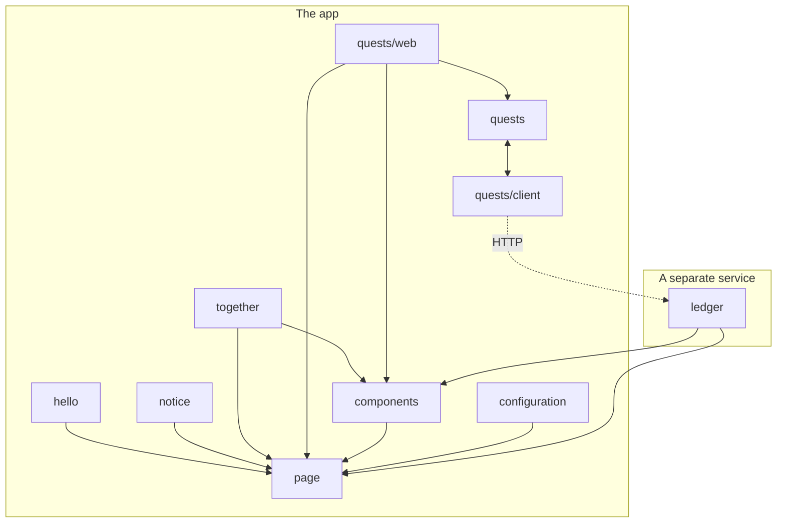

# Forgelord

A starter for web apps in Kotlin and Spring MVC, with [Streamlord](https://streamlord.sobernetics.no)
and [LO-TEK](https://lo-tek.sobernetics.no). Four lessons, each a step from the one before: a page
that says hello, a list with a button, the same list kept up to date in every open window, and a
quest board from [Gallowmark](https://github.com/MarkusAugust/gallowmark) that reads its quests
from another service. Nothing here needs Node or npm.

## How the pages work

The server writes all the HTML. [Datastar](https://data-star.dev), one small script in the browser,
sends what you typed to the server as JSON, and the server answers with new HTML for a part of the
page. You write no JavaScript: what to show, and what is valid, is decided on the server.
Streamlord is the Kotlin side of that: it reads what Datastar sends and writes what it gets back. LO-TEK is the design
system: you call `Lt.button()`, and the button gets LO-TEK's classes.

The words the code and the lessons use:

- **Signal.** A named value Datastar keeps on the page. `dataBind(HelloSignals::name)` ties a
  field to the signal `name`, and Datastar sends every signal as JSON with each request:
  `{"name": "Ada"}`.
- **Patch.** HTML the server sends for one part of the page. Datastar finds the element on the page
  with the same `id` and puts the new one in its place.
- **Morph.** How Datastar puts it in place: it changes only what differs, so a field you are typing
  in keeps its text and the cursor.
- **Stream.** Every Datastar answer here is a stream of server-sent events (SSE). In lessons 1
  and 2 it carries one patch and closes. From lesson 3, the server keeps it open and writes a
  patch whenever something changes.
- **Command.** A POST that changes something on the server, such as "Ride out".
- **Bean.** An object Spring creates once, when the app starts, and keeps. Each class marked
  `@RestController`, `@Service` or `@Component` becomes one, and so does what each `@Bean` function in
  `configuration/` returns.
- **Injection.** Spring passes each bean the beans its constructor asks for. `HelloController` asks
  for a `Streamlord`, and gets the one `StreamlordConfiguration` made.
- **`application.properties`.** The app's settings, in `src/main/resources/`. Spring reads them
  when the app starts.

## Run it

You need Java 21 or newer. Gradle comes with the repository.

```bash
git clone https://github.com/MarkusAugust/forgelord && cd forgelord
./gradlew bootRun
```

Open <http://localhost:8080/hello>. Port 8080 taken? `./gradlew bootRun --args='--server.port=8091'`.

Change the code, compile it, and the open page shows the change: the app restarts by itself,
and the page reloads itself when the app is back. It takes a second or two. What you had typed in
a form is gone, and so is what the Ledger held, since both start again.

- **From a terminal:** run `./gradlew -t classes` in a second terminal. It compiles every time
  you save a file.
- **From IntelliJ IDEA:** start the app with the run configuration `Forgelord`, which comes with
  the repository, in `.run/`. It compiles when you leave IntelliJ IDEA for the browser.
  Build → Build Project (⌘F9) does the same by hand.

The reloading is for development only: it is there when Spring Boot DevTools is, which is never
in the jar. See [`configuration/Development.kt`](src/main/kotlin/forgelord/configuration/Development.kt).

Or, without downloading anything, open it in GitHub Codespaces. The app starts by itself, and the
Streamlord extension is installed.

## Lesson 1: Hello

<http://localhost:8080/hello> has one field and one button. Read
[`hello/HelloController.kt`](src/main/kotlin/forgelord/hello/HelloController.kt) from top to bottom.
It is the whole lesson: the page, what happens when you click, and the HTML that comes back.

`greet` reads the signals with `readSignalsOr(HelloSignals(), streamlord)`. It turns the JSON into
a `HelloSignals`. A signal missing from the JSON gets its default in the class, and a request with
no signals at all gets the `HelloSignals()` given in the call. A request whose body is not JSON is
refused with `415 Unsupported Media Type`.

The exercises are tests that are switched off. Open
[`exercises/HelloExercisesTest.kt`](src/test/kotlin/forgelord/exercises/HelloExercisesTest.kt), delete
the `@Disabled` line above one, and run it from the green arrow beside it. It fails. Change the code
until it passes.

The solutions leave out the imports. When a name turns red in IntelliJ IDEA, put the cursor on it
and press Alt+Enter (⌥↩ on a Mac) to import it.

Each exercise says where the change goes. The link opens the file at that line, as the file is
before any exercise is solved. Once you have added lines above it, look for the name instead.

### Exercise 1: Change the greeting

Make the page greet in your own words. There is no test: you are done when the page says it.

**Where:** [`greetingFor`](src/main/kotlin/forgelord/hello/HelloController.kt#L79) in `hello/HelloController.kt`.

<details><summary>Solution</summary>

Change the text in `greetingFor` in `HelloController.kt`, build, and reload the page. Then run the
tests: `HelloControllerTest` checks the old words, so change them there too.

</details>

### Exercise 2: Where are you from?

Add a second field, "Where are you from?". "Ada" from "Hookford" gets "Hello, Ada from Hookford.";
with no place, still "Hello, Ada.". If you changed the words in exercise 1, keep yours: the test
checks only the name and the place.

**Where:** `hello/HelloController.kt`, in four places: [`HelloSignals`](src/main/kotlin/forgelord/hello/HelloController.kt#L75),
[`greetingFor`](src/main/kotlin/forgelord/hello/HelloController.kt#L79), [`helloForm`](src/main/kotlin/forgelord/hello/HelloController.kt#L81) and [`greet`](src/main/kotlin/forgelord/hello/HelloController.kt#L62).

<details><summary>Solution</summary>

The field is a new signal, so it goes in four places: the class the server reads, the greeting,
the form, and `greet`, which passes the signal on. `when` with nothing after it tries each
condition in turn.

```kotlin
data class HelloSignals(
    val name: String = "",
    val from: String = "",
)

fun greetingFor(name: String, from: String): String =
    when {
        name.isEmpty() -> "Hello, stranger."
        from.isEmpty() -> "Hello, $name."
        else -> "Hello, $name from $from."
    }
```

In `helloForm`, before the button, a `div` of its own:

```kotlin
div {
    val from = Lt.field(id = "from")
    label { lt(from.label); +"Where are you from?" }
    input {
        lt(Lt.input(), from.control)
        dataBind(HelloSignals::from)
    }
}
```

And in `greet`: `greetingFor(signals.name.trim(), signals.from.trim())`.

</details>

### Exercise 3: Count the greetings

Each greeting ends with its number: "Hello, Bo. Greeting number 2.". Open the page in two windows:
they share the count.

**Where:** `hello/HelloController.kt`: a new field in [`HelloController`](src/main/kotlin/forgelord/hello/HelloController.kt#L48), and
[`greet`](src/main/kotlin/forgelord/hello/HelloController.kt#L62).

<details><summary>Solution</summary>

The controller is one object for the whole app, so a field on it is shared by every window.

```kotlin
/** How many greetings, from every window. */
private val greetings = AtomicInteger()
```

In `greet`:

```kotlin
val number = greetings.incrementAndGet()

return response.datastarStream(streamlord, request = request) {
    patchElements(fragment { greeting("${greetingFor(signals.name.trim(), signals.from.trim())} Greeting number $number.") })
}
```

`AtomicInteger`, not an `Int`, because two windows can click at the same moment. If you skipped
exercise 2, call `greetingFor(signals.name.trim())` instead.

</details>

### Exercise 4: Show the name as you type

Under the field, show what is in it, letter by letter as it is typed. The server is not asked:
`dataText` tells Datastar to keep an element's text equal to a signal.

**Where:** [`helloForm`](src/main/kotlin/forgelord/hello/HelloController.kt#L81) in `hello/HelloController.kt`.

<details><summary>Solution</summary>

In `helloForm`, after the `input`:

```kotlin
p {
    lt(Lt.paragraph())
    dataText(signal(HelloSignals::name))
}
```

`signal(HelloSignals::name)` writes `$name`, which is how Datastar refers to the signal `name`.

Now break it on purpose. Write `dataText("$name")` instead. In a Kotlin string, `$name` means a
Kotlin value called `name`, and Kotlin finds one: the `name` attribute of the `form` around the
paragraph. kotlinx.html does not let you reach it from inside `p { }`, so the build fails, and the
message names `var name`. Add `val name = "Ada"` on the line above. Now it compiles, and the page
gets `data-text="Ada"`: Kotlin put its own `name` in the string, and Datastar never sees a signal.
Run the tests: `AnalysisTest` fails and names the line. With the Streamlord plugin in IntelliJ IDEA
or VS Code, the line is marked as you type it. Take both lines out again, and put
`signal(HelloSignals::name)` back.

</details>

### Kotlin in this lesson

All in [`HelloController.kt`](src/main/kotlin/forgelord/hello/HelloController.kt):

- `class HelloController(private val streamlord: Streamlord)`. The constructor's parameters are
  written after the class name, and `val` makes each one a property of the object. Spring calls
  the constructor and passes the `Streamlord` (injection, above).
- `fun page(request: HttpServletRequest): String = page(...)`. A function whose body is one
  expression is written with `=` and no `return`. The `page(...)` after `=` is a different
  function with the same name, from `page/Page.kt`.
- `produces = [MediaType.TEXT_HTML_VALUE]`. An argument given by its name. `[...]` makes an array,
  and is only allowed in annotations.
- `main { h1 { ... } }`. kotlinx.html: each tag is a function, and the code in the braces after it
  writes what goes inside the tag. The braces are a lambda, a function without a name. When a
  lambda is the last argument, it is written after the parentheses, and when it is the only one,
  `()` is left out.
- `+"Hello Gallowmark"`. `+` is an operator kotlinx.html defines on strings: it adds the text
  inside the tag it is in.
- `private fun FlowContent.greeting(text: String)`. An extension function: it is called as if it
  were a method on `FlowContent`, kotlinx.html's type for a tag that can hold other tags, and that
  tag is `this` inside it.
- `request.cspNonce`. An extension property Streamlord adds to the servlet request. It gives this
  request's nonce: a one-time code that lets the page's own scripts run under the
  Content-Security-Policy.
- `data class HelloSignals(val name: String = "")`. A data class gets `equals`, `toString` and
  `copy` made for it. `= ""` is the value used when the JSON has no `name`.
- `dataBind(HelloSignals::name)`. `::` gives the property itself, not its value, and the function
  takes the signal's name from it. Misspell it, and the code does not compile. `dataBind` here is
  from [`page/Signals.kt`](src/main/kotlin/forgelord/page/Signals.kt); Streamlord's own takes the
  name as a string, which nothing checks.
- `if (name.isEmpty()) "Hello, stranger." else "Hello, $name."`. `if` is an expression: it gives a
  value, so it can be the whole body after `=`. `$name` in a string puts in the value of `name`.

## Lesson 2: A list and a command

<http://localhost:8080/notice> shows three quests, each with a "Ride out" button. Read
[`notice/NoticeController.kt`](src/main/kotlin/forgelord/notice/NoticeController.kt).

What is new since lesson 1: the cards come from a list, the URL says which quest was clicked, and
the server keeps a count. Click "Ride out" and the card shows the new count.

`rideOut` needs no signals, but calls `readSignals(streamlord)` anyway. It gives the signals as
plain JSON, with no class to put them in, and refuses a body that is not JSON with 415, as
`readSignalsOr` does. The refusal is why it is there: an HTML form on another site can send form
data or plain text, never JSON, so it cannot make a visitor ride out without knowing it.

Open the page in a second window, and click there. The first window still shows the old number,
until you reload it. The answer to a click goes only to the window that clicked.

### Exercise 5: A badge for a popular quest

When three or more have ridden out on a quest, its card shows a badge that says "Popular". The
test is in [`exercises/NoticeExercisesTest.kt`](src/test/kotlin/forgelord/exercises/NoticeExercisesTest.kt).

**Where:** [`noticeCard`](src/main/kotlin/forgelord/notice/NoticeController.kt#L101) in `notice/NoticeController.kt`.

<details><summary>Solution</summary>

In `noticeCard`, after the paragraph with the count:

```kotlin
if (riders >= 3) {
    span { lt(Lt.badge(color = BadgeColor.SUCCESS)); +"Popular" }
}
```

Only the card changes. The count was already there: `riders` is the card's parameter.

</details>

### Kotlin in this lesson

All in [`NoticeController.kt`](src/main/kotlin/forgelord/notice/NoticeController.kt):

- `val NOTICES = listOf(...)`. A list that cannot be changed. It is declared outside the class, so
  it is one list for the whole app.
- `for (notice in NOTICES) { noticeCard(...) }`. A loop inside `main { }` writes one card for each
  quest.
- `NOTICES.associate { it.id to AtomicInteger() }` in `riders`. In a lambda with one parameter,
  `it` is that parameter. `a to b` makes a pair, and `associate` makes a map from the pairs.
- `@PathVariable id: String` in `rideOut`. The `{id}` part of `/notice/{id}/ride`.
- `NOTICES.find { it.id == id } ?: throw ResponseStatusException(HttpStatus.NOT_FOUND)`. `find`
  gives a `Notice?`: a `Notice`, or `null` when none matches. `?:` gives what is on its right
  when what is on its left is `null`. After the line, Kotlin knows `notice` is not `null`.
- `riders.getValue(id)`. Looks up a key that must be there, and throws an exception if it is not.
  `riders[id]` would give `null` for a missing key.
- `when (count) { 0 -> ...; 1 -> ...; else -> ... }` in `ridersText`. Picks the first branch that
  matches, and gives its value.
- `"notice-${notice.id}"`. `${...}` is needed when what goes in the string is more than a plain
  name, such as `notice.id`.

## Lesson 3: Every window sees it

<http://localhost:8080/together> is lesson 2's list again. Open it in two windows and ride out in
one: both show the new count. Read
[`together/TogetherController.kt`](src/main/kotlin/forgelord/together/TogetherController.kt), and
compare it with lesson 2's.

What changed:

- **The count is a `MutableStateFlow`.** It holds a map from quest to count, and tells every open
  stream when the map is replaced.
- **Each page opens a stream as it loads, to `/together/board`.** The server holds that request
  open, and sends the cards down it at once, then again whenever the count changes.
- **"Ride out" answers `204 No Content`.** The answer has no HTML, because the new cards come down
  every window's stream, the clicking one's included.
- **The cards come from `cardList` in `components/`,** and the section around them from `shell`.
  Lesson 2 wrote its card by hand. A component is a function more than one page uses; the board
  in lesson 4 uses the same two. Inside `cardList`'s last lambda, `this` is a `FlowContent`, so
  `h3 { }` and the other tags work there.

### Exercise 6: Turn back

A "Turn back" button beside "Ride out" takes one rider off the quest, never below none, and every
open window shows the new count. The test is in
[`exercises/TogetherExercisesTest.kt`](src/test/kotlin/forgelord/exercises/TogetherExercisesTest.kt).

**Where:** `together/TogetherController.kt`: a new command beside [`rideOut`](src/main/kotlin/forgelord/together/TogetherController.kt#L119), and a
button in [`cards`](src/main/kotlin/forgelord/together/TogetherController.kt#L148).

<details><summary>Hint</summary>

`rideOut` is the pattern. A command changes `riders` and answers 204. It sends no HTML: the
stream does that, for every window. What differs here is the URL, and what happens to the count.

</details>

<details><summary>Solution</summary>

A second command beside `rideOut`:

```kotlin
@PostMapping("/together/{id}/turn-back")
@ResponseStatus(HttpStatus.NO_CONTENT)
fun turnBack(
    @PathVariable id: String,
    request: HttpServletRequest,
) {
    request.readSignals(streamlord)
    if (id !in riders.value) throw ResponseStatusException(HttpStatus.NOT_FOUND)

    riders.update { counts -> counts + (id to maxOf(0, counts.getValue(id) - 1)) }
}
```

And in `cards`, at the bottom of the file, after the "Ride out" button:

```kotlin
button {
    lt(Lt.button(variant = ButtonVariant.GHOST))
    type = ButtonType.button
    dataOnClick(post("/together/${quest.id}/turn-back"))
    +"Turn back"
}
```

Nothing else: the stream already sends the cards whenever `riders` changes.

</details>

### Kotlin in this lesson

All in [`TogetherController.kt`](src/main/kotlin/forgelord/together/TogetherController.kt):

- `MutableStateFlow(...)`, `riders.value` and `riders.update { ... }`. From kotlinx.coroutines.
  `value` is what the flow holds now, and `update` replaces it. You write no coroutine code here:
  `sendLatest`, in the endpoint `board`, reads the flow for you.
- `counts + (id to counts.getValue(id) + 1)` in `rideOut`. A map plus a pair is a new map, with
  that key's value replaced. The old map is not changed. `+` is done before `to`, so the pair is
  `id` and the count plus one.
- `id !in riders.value`. `in` on a map asks whether the key is there.
- `@ResponseStatus(HttpStatus.NO_CONTENT)` on `rideOut`. Makes Spring answer 204 instead of 200.
  The function returns nothing, so the body is empty.
- `cardList(QUESTS, cardId = { "together-${it.id}" }) { quest -> ... }`. Two lambdas: one passed
  by name, and the last one after the parentheses. `quest ->` names the lambda's parameter instead
  of `it`.
- `const val TOGETHER_BOARD_ID`. A constant, known when the code is compiled.
- `fun <T> FlowContent.cardList(items: List<T>, ...)` in
  [`CardList.kt`](src/main/kotlin/forgelord/components/cardlist/CardList.kt). `<T>` is a type
  parameter: the list can hold any type, and `cardId` and the card get items of that type.

## Lesson 4: The board

<http://localhost:8080> is the quest board at Hookford. Ride out on a quest, or nail up your own.
Open it in two windows, and both follow, as in lesson 3.

What is new: the board reads its quests from the Ledger, a separate service it calls over HTTP.
Here the Ledger runs in the same app, at <http://localhost:8080/ledger>, where you can open it,
wipe it or close it.

The page, the stream and the commands work as in lesson 3. But lesson 3 was one file, and the
board is several folders. So this lesson comes in four steps. Each step names the few files it is
about, and ends with an exercise. The exercises are in
[`exercises/BoardExercisesTest.kt`](src/test/kotlin/forgelord/exercises/BoardExercisesTest.kt).

### Where the code is

This is a map to look things up in. You need none of it by heart: each step says where to read.
Each box is a folder under `src/main/kotlin/forgelord/`, and an arrow means "uses": `quests/web`
imports from `components`.



Each lesson's folder uses only `page/` and `components/`, never another lesson's. `page/` uses
none of the others, and `components/` knows nothing of quests, so both can go into
another app as they are. Nothing in the app imports `ledger/`: the board reaches it over HTTP, the
way it would reach a real service. It runs in the same app only so there is one thing to start.
`quests` and `quests/client` use each other, since the service calls the client and the client
turns the Ledger's JSON into the board's own types.
`configuration/` sets up Streamlord, the Content-Security-Policy, the Ledger's address and the
scope the board asks the Ledger in, and Spring hands them to the rest. In development it also
gives `page/` the script that reloads an open page.

```text
src/
├── main/
│   ├── kotlin/forgelord/
│   │   ├── hello/          Lesson 1, in one file
│   │   ├── notice/         Lesson 2, in one file
│   │   ├── together/       Lesson 3, in one file
│   │   ├── quests/         the board's types, and the service that reads them
│   │   │   ├── web/        the controller, the views and the form's rules
│   │   │   └── client/     the Ledger over HTTP
│   │   ├── components/     what every page can use: field, card list, toast and more
│   │   ├── page/           the page around everything: LO-TEK, the CSS, the scripts, signals by property
│   │   ├── configuration/  Streamlord, the Content-Security-Policy, the Ledger's address, the scope, reloading in development
│   │   └── ledger/         the stand-in for a real source service
│   └── resources/static/   datastar.js, forgelord.js, which loads LO-TEK, and development-reload.js
└── test/kotlin/forgelord/
    └── exercises/          the exercises, switched off
```

### Step 1: Read from another service

In lesson 3 the count lived in the controller, in a `MutableStateFlow`. Here the quests live in
the Ledger, and the board has to ask for them. The Ledger can be slow, empty or closed, so the
board has four states: loading, with quests, empty, and closed.

Read these, in this order:

| Where | What |
| --- | --- |
| [`quests/QuestResult.kt`](src/main/kotlin/forgelord/quests/QuestResult.kt) | `QuestResult`: the four states. `Reading`: what the Ledger answered |
| `quests` in [`quests/client/QuestClient.kt`](src/main/kotlin/forgelord/quests/client/QuestClient.kt) | Asks the Ledger over HTTP, and turns its JSON into the board's own `Quest`. It never throws: a Ledger that fails is `Reading.Closed` |
| [`quests/QuestService.kt`](src/main/kotlin/forgelord/quests/QuestService.kt) | `board` is a `StateFlow`, as `riders` was in lesson 3, but filled by asking the Ledger |
| `boardView` in [`quests/web/QuestView.kt`](src/main/kotlin/forgelord/quests/web/QuestView.kt) | One rendering for each of the four states |
| `board` in [`quests/web/ViewController.kt`](src/main/kotlin/forgelord/quests/web/ViewController.kt) | The stream. It is lesson 3's, with `quests.board` in place of `riders` |

The board asks the Ledger again every two seconds while any window has it open, and a Ledger that
takes more than two seconds to answer counts as closed.

### Exercise 7: Four states

Keep the board open in one window and `/ledger` in another. Wipe the Ledger, close it, open it.
There is no test: you are done when you have seen the board loading, with quests, empty, and closed.
Nail up a quest while the Ledger is closed, and see what you get.

**Where:** in the browser. No file changes.

### Step 2: A command that can fail

In lesson 3, "Ride out" changed a map in memory, and that cannot fail. Here it is a request to
another service, which may be closed, or may no longer have the quest. Follow one click, from the
button to the Ledger:

| Where | What |
| --- | --- |
| `questCard` in [`quests/web/QuestView.kt`](src/main/kotlin/forgelord/quests/web/QuestView.kt) | The button. It posts to `/quests/{id}/ride` |
| `rideOut` in [`quests/web/ViewController.kt`](src/main/kotlin/forgelord/quests/web/ViewController.kt) | The command. 204 when it went through, and a toast for the one who clicked when it did not |
| `rideOut` in [`quests/QuestService.kt`](src/main/kotlin/forgelord/quests/QuestService.kt) | Hands the ride to the client, and reads the board again |
| `rideOut` and `write` in [`quests/client/QuestClient.kt`](src/main/kotlin/forgelord/quests/client/QuestClient.kt) | The request to the Ledger, and its status code turned into a `WriteResult` |
| `WriteResult` in [`quests/QuestResult.kt`](src/main/kotlin/forgelord/quests/QuestResult.kt) | What became of a write: `DONE`, `CLOSED` or `GONE` |

Each file knows only the next one in the table. The view knows a URL. The controller knows the
service. The service knows the client. Only the client knows that the Ledger speaks HTTP.

A ride that failed is answered with 200, not with an error status: Datastar runs nothing from an
error status, and the toast is a script the page has to run.

### Exercise 8: Turn back, on the board

Exercise 6 again, on the board: a "Turn back" button beside "Ride out" takes one rider off the
quest. The Ledger can already do it. `DELETE /ledger/quests/{id}/riders` answers as a ride does,
and never goes below none. The board does not ask for it yet. When the Ledger does not take it,
the one who clicked gets the toast a ride gives, ending "Nobody turned back."

**Where:** four files, from the client to the page. In each, the new code goes beside what "Ride
out" has there:

1. [`rideOut`](src/main/kotlin/forgelord/quests/client/QuestClient.kt#L54) in `quests/client/QuestClient.kt`
2. [`rideOut`](src/main/kotlin/forgelord/quests/QuestService.kt#L48) in `quests/QuestService.kt`
3. [`rideOut`](src/main/kotlin/forgelord/quests/web/ViewController.kt#L100) in `quests/web/ViewController.kt`
4. [`questCard`](src/main/kotlin/forgelord/quests/web/QuestView.kt#L92) in `quests/web/QuestView.kt`

<details><summary>Hint</summary>

In lesson 3 this was one function and one button. Here the function is in three parts. The client
makes the request: `ledger.delete()` where a ride has `ledger.post()`. The service passes it on,
and reads the board again. The controller turns the `WriteResult` into 204 or a toast.

Build after each file. Until the controller has its command, nothing calls the new code, and that
is fine.

</details>

<details><summary>Solution</summary>

In `QuestClient`, beside `rideOut`. `write` already turns the Ledger's status codes into a
`WriteResult`:

```kotlin
fun turnBack(id: String): WriteResult =
    write {
        ledger
            .delete()
            .uri("/ledger/quests/{id}/riders", id)
            .retrieve()
            .toBodilessEntity()
    }
```

In `QuestService`, beside `rideOut`:

```kotlin
fun turnBack(id: String): WriteResult = client.turnBack(id).also { readAgain() }
```

In `ViewController`, after `rideOut`. It is `rideOut` again, with another URL and other words:

```kotlin
@PostMapping("/quests/{id}/turn-back")
fun turnBack(
    @PathVariable id: String,
    request: HttpServletRequest,
    response: HttpServletResponse,
): StreamingResponseBody? {
    request.readSignals(streamlord)

    val why =
        when (quests.turnBack(id)) {
            WriteResult.DONE -> {
                response.status = HttpStatus.NO_CONTENT.value()
                return null
            }
            WriteResult.GONE -> "That quest is no longer on the post."
            WriteResult.CLOSED -> "The Ledger did not take it."
        }
    return response.datastarStream(streamlord, request = request) {
        executeScript(showDangerToast(TOASTS_ID, "$why Nobody turned back."))
    }
}
```

And in `questCard` in `QuestView.kt`, after the "Ride out" button:

```kotlin
button {
    lt(Lt.button(variant = ButtonVariant.GHOST))
    type = ButtonType.button
    dataOnClick(post("/quests/${quest.id}/turn-back"))
    +"Turn back"
}
```

Four files for what took one in lesson 3. What they buy: the Ledger could change its URL or its
JSON, and only the client would change. The words on the toast could change, and only the
controller would.

</details>

### Step 3: A form the server judges

The browser checks nothing. The form's fields are signals, and "Nail it up" sends them all. The
server decides what is wrong, and answers with the form again, with each fault at its field.
Datastar morphs it in, so the fields keep what was typed.

| Where | What |
| --- | --- |
| [`quests/web/QuestForm.kt`](src/main/kotlin/forgelord/quests/web/QuestForm.kt) | The form's signals, and `check`: the rules for a new quest, on the server and nowhere else |
| [`quests/web/QuestFormView.kt`](src/main/kotlin/forgelord/quests/web/QuestFormView.kt) | The HTML of the form, with the server's verdict on each field |
| `nail` in [`quests/web/ViewController.kt`](src/main/kotlin/forgelord/quests/web/ViewController.kt) | The command. Unlike a ride, it answers with HTML: the form again |
| [`quests/Quest.kt`](src/main/kotlin/forgelord/quests/Quest.kt) | `NewQuest`: a quest that has passed the rules. Only `check` can make one |

### Exercise 9: Keep the task short

"What has to be done" may be at most 300 characters. Longer, and the form says so at that field.

**Where:** [`check`](src/main/kotlin/forgelord/quests/web/QuestForm.kt#L57) in `quests/web/QuestForm.kt`. No other file
changes.

<details><summary>Solution</summary>

Beside the other limits:

```kotlin
private const val TEXT_MAX = 300
```

In `check`, in place of the line that checks `trimmedText`:

```kotlin
when {
    trimmedText.isEmpty() -> add(Fault(QuestForm::text, "Say what has to be done."))
    trimmedText.length > TEXT_MAX -> add(Fault(QuestForm::text, "No more than $TEXT_MAX characters."))
}
```

The form already shows each `Fault` at its field, and in the summary above the form.

</details>

### Step 4: From the Ledger to the page

The last exercise changes every layer, and the Ledger too, as you would ask the team that owns a
real one. Read the Ledger first:

| Where | What |
| --- | --- |
| [`ledger/Ledger.kt`](src/main/kotlin/forgelord/ledger/Ledger.kt) | The entries, in memory, and the switch that opens, wipes and closes it |
| [`ledger/LedgerController.kt`](src/main/kotlin/forgelord/ledger/LedgerController.kt) | Its JSON API under `/ledger/quests`, with a status code for each outcome |

### Exercise 10: A name already on the post

Nailing up a quest with the name of one already on the post shows "<the name> is already on the
post." at the name field, and nothing goes up. Capital letters do not count: "a tenth of the wood"
is the same name as "A Tenth of the Wood".

**Where:** five files, from the Ledger to the page. Take them in this order:

1. [`Ledger`](src/main/kotlin/forgelord/ledger/Ledger.kt#L34) in `ledger/Ledger.kt`
2. [`add`](src/main/kotlin/forgelord/ledger/LedgerController.kt#L36) in `ledger/LedgerController.kt`
3. [`WriteResult`](src/main/kotlin/forgelord/quests/QuestResult.kt#L35) in `quests/QuestResult.kt`
4. [`write`](src/main/kotlin/forgelord/quests/client/QuestClient.kt#L64) in `quests/client/QuestClient.kt`
5. [`nail`](src/main/kotlin/forgelord/quests/web/ViewController.kt#L70) and [`rideOut`](src/main/kotlin/forgelord/quests/web/ViewController.kt#L100)
   in `quests/web/ViewController.kt`

<details><summary>Hint</summary>

Who should refuse the name, the board or the Ledger? Think of two people who nail up the same
name at the same moment.

Then work from the Ledger and outwards. The Ledger needs a status code that means "taken". The
client needs a word for that status code, in `WriteResult`. The controller needs to say it at the
name field. Once the new word is in `WriteResult`, build: the compiler names the places that have
to handle it.

</details>

<details><summary>Solution</summary>

The Ledger owns the quests, so the Ledger refuses the name, with `409 Conflict`. If the board
checked first, two people could still nail up the same name at the same moment, between the
board's check and the Ledger's write.

In `Ledger.kt`:

```kotlin
@Synchronized
fun has(title: String): Boolean = !closed && entries.any { it.title.equals(title, ignoreCase = true) }
```

In `LedgerController.add`:

```kotlin
if (ledger.has(entry.title)) {
    ResponseEntity.status(HttpStatus.CONFLICT).build()
} else {
    ledger.add(entry)?.let { ResponseEntity.status(HttpStatus.CREATED).body(it) }
        ?: ResponseEntity.status(HttpStatus.SERVICE_UNAVAILABLE).build()
}
```

Add `TAKEN` to `WriteResult` in `QuestResult.kt`. The client is where a status code becomes one
of the board's words, so in `QuestClient.write`, catch the conflict before `Exception`. `Conflict`
is a kind of `Exception`, and Kotlin uses the first `catch` that matches:

```kotlin
} catch (_: HttpClientErrorException.Conflict) {
    WriteResult.TAKEN
} catch (e: Exception) {
```

`QuestService` hands the result on as it is, and needs no change.

Now build. The build fails twice in `ViewController`: neither `when` over the result covers every
case any more. In `nail`, add the branch:

```kotlin
WriteResult.TAKEN ->
    patchElements(fragment { questForm(emptySignals, listOf(Fault(QuestForm::name, "${checked.quest.name} is already on the post."))) })
```

A ride is never `TAKEN`, so in `rideOut` it joins the branch that says the least:

```kotlin
WriteResult.CLOSED, WriteResult.TAKEN -> "The Ledger did not take it."
```

If you solved exercise 8, the build fails in `turnBack` too. It gets the same line.

</details>

### Kotlin in this lesson

- `sealed interface QuestResult` in [`QuestResult.kt`](src/main/kotlin/forgelord/quests/QuestResult.kt),
  with `data object Loading` and `data class Found`. A sealed type has a fixed set of subtypes, all
  in the same package. A `data object` is a type with exactly one value, whose `toString` gives
  its name.
- `when (result) { QuestResult.Loading -> ...; is QuestResult.Found -> ... }` in `boardView`. `is`
  checks the type, and in that branch `result` has it: `result.quests` works. Leave a state out,
  and the build fails.
- `enum class WriteResult { DONE, CLOSED, GONE }`. A fixed set of values.
- `object QuestPageClasses` and `val questPageCss by lazy { ... }` in
  [`QuestPageClasses.kt`](src/main/kotlin/forgelord/quests/web/QuestPageClasses.kt). An `object`
  is a class with exactly one instance. `by lazy` works the value out the first time it is read.
- `buildList { add(...) }` in `QuestForm.check`. Makes a list by adding to it inside the braces.
- `data class NewQuest private constructor(...)` in [`Quest.kt`](src/main/kotlin/forgelord/quests/Quest.kt),
  with `@PassedTheRules fun of(...)`. Nobody outside the class can call a private constructor.
  `@RequiresOptIn` on the annotation makes every call to `of` a compile error until the caller
  writes `@OptIn(PassedTheRules::class)`, as `QuestForm.check` does.
- `QuestForm::name` in `Fault(QuestForm::name, ...)`. A reference to the property itself, not its
  value. The form gets the field's id and its signal from it, so the name is written once, in the
  class, and a field that does not exist does not compile.
- `try { ... } catch (_: HttpClientErrorException.NotFound) { ... }` in `QuestClient.write`. `try`
  gives a value, as `if` does. `_` in place of a name says the exception is not used.
- The `flow { ... }.stateIn(...)` in `QuestService.board` is coroutines. You can read the rest
  without it: `board` is a `StateFlow` as in lesson 3, and this code fills it by asking the Ledger.

## When you build on it

The lessons do not need this section.

**Rules, and the tests that hold them.** Markup is kotlinx.html, never HTML in strings. A CSS class
is a constant in a `…Classes` object or comes from LO-TEK, never a free string. `unsafe { }` is used
once, for the page's CSS. Eight tests hold the structure:

- `ArchitectureTest` has one table of what each folder uses of the others, and checks the code
  against it. A new folder needs a row before it can use anything.
- `ComponentStylesTest` checks that the components' CSS names no domain, and that every file of it
  is on the page.
- `ClassesTest` checks that every class constant is in its CSS file, and the other way round.
- `UnsafeTest` checks that `unsafe { }` is where it may be.
- `SignalNamesTest` checks that no signal is named by a string.
- `NewQuestTest` checks that only the file with the form's rules opts in to making a `NewQuest`.
- `InstructionsTest` checks that `CLAUDE.md` imports every instruction file.
- `ReadmeTest` checks that the diagram and the tree in lesson 4 name every folder, and that the
  diagram's arrows are the ones in `ArchitectureTest`.

`AnalysisTest` runs the Streamlord editors' check over every source file.

A new page with its own CSS needs a CSS file, a `…Classes` object beside it, and a line in
`ClassesTest`. A new component's CSS also goes in `ComponentStyles.FILES`.

**Security.** Every page is served with a strict Content-Security-Policy and a new nonce per
request (`configuration/StreamlordConfiguration.kt`), and `ContentSecurityPolicyTest` checks it on
a running server. Scripts are files, never inline. Every command reads the signals, even when it
needs none, so a form on another site cannot post to it.

**Your own source service.** To read from a real service instead of the Ledger:

1. Delete `ledger/` and its tests in `src/test/kotlin/forgelord/ledger/`. Take `LedgerPageClasses`
   out of `ClassesTest`, the `ledger` row out of `ArchitectureTest`, `/ledger` out of
   `ContentSecurityPolicyTest`, and `ledger` out of the diagram and the tree in this README.
   `LiveBoardTest` wipes, closes and opens the Ledger through its switch: point it at a stand-in
   of your service, or delete it.
2. Set `forgelord.ledger.url` in `application.properties` to the service's address.
3. Remove `@Lazy` from `LedgerConfiguration` and `QuestClient`. It is only there because the Ledger
   runs in this app, whose port is known late.
4. Change `QuestDto` to the service's JSON.

## For coding agents

The instructions are in `.github/copilot-instructions.md` and `.github/instructions/`, where GitHub
Copilot finds them. `CLAUDE.md` imports the same files for Claude Code.
